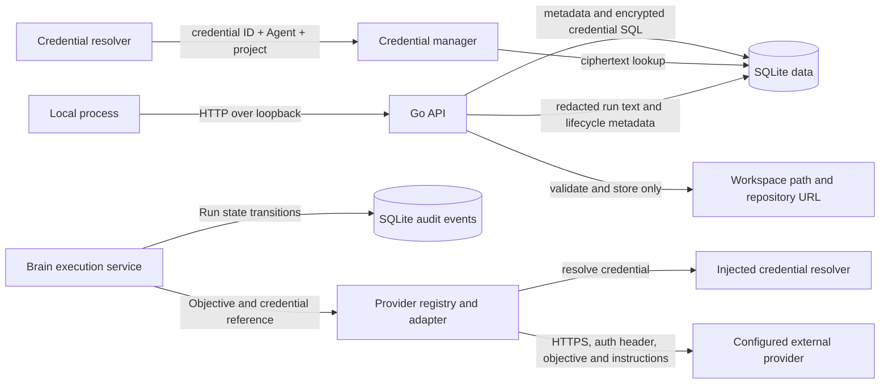

# boAIrd Threat Model

> This model distinguishes controls present in source from documented future goals. Threat rows describe plausible risks; they are not claims of confirmed vulnerabilities.

## 1. Current implementation and scope

boAIrd currently starts a local Go HTTP service with a SQLite database. The service exposes health/status endpoints, project create/list/read/update/archive operations, metadata-only credential management, agent configuration create/list/read/update operations, Brain execution and run history, Kanban task create/list/read/assign/transition operations, and orchestrator dispatch/review operations that execute assigned API Agents and apply the Brain verdict with bounded retries and escalation. The configured host must be a loopback IP address; the default is `127.0.0.1:3110`. Project rows may contain a name, description, Brain reference, workspace path, repository URL, lifecycle state, and human-review flag.

Provider-neutral request/model types, a registry, and adapters for OpenAI, Anthropic, DeepSeek, Gemini, and OpenAI-compatible APIs are implemented under `internal/provider`. Adapters resolve credentials through an injected `CredentialResolver`, use HTTPS by default (HTTP only for explicit loopback), disable redirects and proxies, validate DNS answers at dial time, pin the validated address for the connection, bound request/response sizes and request duration, and omit provider error bodies from returned HTTP errors. Built-in vendor hosts are allowed; custom hosts require an exact `BOAIRD_PROVIDER_ALLOWED_HOSTS` entry. Private, link-local, metadata, and other special-use destination IP ranges are blocked unless explicitly included in `BOAIRD_PROVIDER_ALLOWED_IP_RANGES`. The application configures the provider registry for Brain execution on demand. Credential ciphertext is stored in SQLite using AES-256-GCM with a deployment-supplied `BOAIRD_MASTER_KEY`; the key is not stored in the database. All versioned REST routes except status require `BOAIRD_LOCAL_AUTH_TOKEN`, which authenticates the single `local-administrator` principal and is compared in constant time. The browser exchanges the root token for a 30-minute HttpOnly, SameSite=Strict cookie containing a random opaque session ID held in server memory; logout revokes it, restart invalidates it, and unsafe cookie requests require a trusted dashboard Origin. Direct Bearer authentication remains available to local API clients. Structured logs redact sensitive attribute names and common bearer/provider token patterns.

Agent configuration validates runtime, provider/model/credential references, languages, instructions, and explicit capabilities. The `role` field is descriptive and does not grant capabilities. Agent project scope is persisted in `agent_projects`, loaded with Agent records, and managed by authenticated administrator routes; actual membership changes are recorded in immutable audit history. REST operations map to explicit capabilities in a Go authorizer, and project-scoped administrator routes require `project_members` membership. The authenticated MCP Agent must have the required capability and explicit persisted project membership for project-wide operations. An exact task assignment permits only task-specific operations after the task is loaded and its assignee is checked; it never adds project scope. An active Brain gets scope only from its Brain-to-project relation. Cross-project MCP denials are recorded in the immutable authorization denial table. Projects can attach one active Brain to an API or authenticated MCP agent with the explicit `brain.execute` capability. API Brain objectives invoke the configured provider and persist a Run; an MCP Brain uses its authenticated, capability-checked tools, while the provider-run endpoint rejects MCP Brains without creating a run. Provider output remains proposed text and does not itself mutate tasks or project policy. Brain task actions pass a separate autonomy gate: `MANUAL` is plan-only, `SEMI_AUTO` permits capable task creation, assignment, transitions, and review but requires human approval for completion, and `AUTONOMOUS` may complete only when `task.complete` is granted and project human review is disabled. Autonomy never adds capabilities. Only the administrator can change the Brain mode, and the mode change is recorded in immutable audit. The task service persists tasks, checks workflow transitions and explicit agent/Brain/administrator capabilities, applies project human-review policy, and records immutable audit events for mutations. It rejects the legacy unprivileged local actor. Conversations are stored per task; agent messages require assignment to that task and Brain messages require the project's active Brain. Human conversation reads/writes require the configured local bearer token and a `project_members` row; new projects and existing projects are assigned to the single local administrator. Message history is bounded and cursor-paginated. Message content and metadata are redacted before persistence. Caller-supplied sender identity is rejected. Project workspace paths and repository URLs are validated and persisted; the project API does not read workspace files, clone repositories, or fetch repository URLs. Loopback binding limits network exposure but does not isolate local processes that possess the administrator token.

MCP Agent tokens are issued, rotated, revoked, and listed through authenticated administrator routes. Tokens are random 32-byte values with explicit expiry capped at 365 days; only their SHA-256 verifiers and metadata are stored. Plaintext is returned once. Legacy environment tokens are imported once with a 90-day expiry. Token lifecycle events are immutable and do not contain secret material. Verification runs on every MCP HTTP request, so revocation blocks subsequent requests on existing sessions; a request or stream already in progress may finish. Access to the SQLite file or process memory remains within the trusted local host boundary.

| Surface | Implemented behavior | Security boundary and limitation |
| --- | --- | --- |
| CLI and configuration | `boaird serve`; reads host/port/database settings and requires `BOAIRD_MASTER_KEY` and `BOAIRD_LOCAL_AUTH_TOKEN` as 64 hexadecimal characters. Host must parse as a loopback IP. | No authenticated remote mode. Every versioned route except status requires the token or browser cookie; route capabilities and project membership are checked in Go. |
| HTTP API | Health/status, project CRUD/archive, credential create/list/delete, agent configuration, Brain attach/read/replace/execution/run history, task workflow, and task conversation endpoints. Credential responses contain only ID, name, and provider; request JSON is size-limited and rejects unknown fields. Task mutation requests require a reason and actor identity is fixed by the server. Conversation routes authenticate the local administrator and check project membership; Brain replacement authenticates the same principal and records an audit reason. | The single-principal membership model is not multi-user identity management. Any process that obtains the administrator token or can use the authenticated browser session has administrator authority; local OS users remain outside the application authorization boundary if they can inspect process/browser state. |
| Agent configuration and scope | Agent create/list/read/update and administrator-managed project memberships; role is descriptive, runtime status is read-only, explicit capabilities are stored, and project IDs load from `agent_projects`. Membership and credential-binding changes are audited. Provider credential resolution requires the Agent credential binding plus project membership or the active Brain relationship. | Only the authenticated local administrator can configure Agents and scope. Role labels do not grant authority. Project-wide MCP actions require persisted scope; task assignment grants access only to that exact task. |
| Brain and runs | Project Brain attach/read/replace and objective execution; replacement requires the local administrator bearer token and audit reason; only API or authenticated MCP agents with `brain.execute` may be attached; provider output and run state are persisted; autonomy does not grant capability. | API Brain runs return proposed text only and do not apply mutations. MCP Brain actions use authenticated tools with explicit capabilities, project scope, and domain policy; the local provider-run endpoint rejects this runtime. Brain attachment and replacement require the authenticated administrator; provider-bound objectives/responses may contain sensitive data. |
| Run history and audit | Run input/output/tool/error text is redacted for common secret patterns before persistence and display. SQLite creates immutable audit rows for Run creation/status changes and Brain replacement; project history filters Runs by task and agent. | Redaction is pattern-based and cannot identify every secret format. Run content is stored as plaintext in SQLite after redaction. SQL triggers protect audit rows from application updates/deletes but do not protect against an OS user who can directly alter the database file. |
| Task workflow and audit | Backend validates task state transitions, rejects worker task creation by default, checks explicit capabilities for Brain/agent actions, applies human-review policy, and stores actor/reason on mutations. SQLite records immutable creation, assignment, and status events. | The API derives the administrator actor only after authentication; the task service independently checks explicit capability and project scope. Authorization denials are stored immutably. Audit triggers do not protect against an OS user who can alter the SQLite database or schema directly. |
| Task conversations | Every task has one persisted conversation. Messages store opaque content, content type, JSON metadata, sender identity, and timestamp. The HTTP API requires a configured bearer token and project membership for human reads/writes; agent/Brain sender identities are checked against task assignment or the active project Brain. History is cursor-paginated and content is redacted. | The token maps to one configured local administrator, not individual human accounts. Other versioned API routes use the same token/session authentication and capability checks. Redaction is pattern-based and cannot identify every secret. Conversation rows are not protected by immutable audit events. |
| SQLite | Opens/migrates the configured database; creates parent directories with mode `0700` and database file mode `0600`. Credential secrets are stored only as AES-256-GCM ciphertext; agent rows store provider configuration and credential IDs. | Permissions on a pre-existing parent directory are not changed. Local OS users with database access can read or replace ciphertext and metadata. |
| Project data | Validates project names, workspace paths, repository URL schemes, page limits, and Brain references; SQL uses parameters. | Workspace and repository values are stored, not acted upon by this API. No tenant boundary exists. |
| Provider adapters | Provider-specific chat/model requests; credential reference resolved immediately before each HTTP call; bounded JSON transport and sanitized HTTP status errors. The Brain runtime invokes chat on demand. | Prompt objectives and Brain instructions are sent to the configured provider. No context-selection/consent policy or provider endpoint allowlist is implemented here. |
| MCP, tools, dashboard, general audit | The standalone Angular dashboard, authenticated MCP adapter, and REST authorization are implemented. MCP uses expiring token verifiers, administrator-only issue/rotate/revoke operations, and immutable lifecycle audit; explicit capabilities and persisted Agent project scope apply to tool calls. Revocation is checked on every HTTP request. | The current administrator is a single local principal; audit data and verifiers are stored in SQLite and do not protect against an OS user who can alter the database, schema, or process memory directly. A request or stream already in progress may finish after token revocation. |

### Effective configuration and data locations

| Resource | Configuration | Current default or enforcement | Security notes |
| --- | --- | --- | --- |
| HTTP listener | `BOAIRD_HOST`, `BOAIRD_PORT` | `127.0.0.1:3110`; non-loopback IPs are rejected. | HTTP is used on loopback. All versioned routes except status authenticate the local administrator. Same-host processes that can read the configured token or use the active browser session remain trusted. |
| Local administrator identity | `BOAIRD_LOCAL_AUTH_TOKEN` | Required 32-byte bearer token encoded as 64 hexadecimal characters; maps to `local-administrator`. | Keep separate from `BOAIRD_MASTER_KEY`. The dashboard exchanges the token for a session-only HttpOnly cookie. Token rotation requires updating the environment and restarting the process. |
| SQLite database | `BOAIRD_DATABASE_PATH` | `./data/boaird.db`; newly created parent/file modes are `0700`/`0600`. | A caller may choose another path; existing parent-directory permissions and symlink ownership are not hardened by the current code. |
| Provider endpoint | `provider.Config.BaseURL` and `EndpointPolicy` | Vendor defaults and explicit loopback endpoints are allowed; custom hosts require an exact configured allowlist entry; resolved private/special-use ranges require a CIDR allowlist entry. DNS answers are checked and pinned at dial time; redirects and proxies are disabled. | The local administrator can approve an arbitrary host or IP range. An approved endpoint can receive provider credentials and prompts; DNS and public routing remain external dependencies. |
| Provider credential | `BOAIRD_MASTER_KEY`, credential ID, Agent ID, and project ID | Secret is encrypted at rest and returned by the credential API only as metadata. Resolution requires the credential to be attached to the requesting Agent and the Agent to have persisted membership in the requested project or be that project's active Brain; provider names must match. Missing or mismatched scope fails closed. | Master key is held in process memory and supplied by deployment; key rotation and multi-user credential metadata filtering are not implemented. |
| Workspace/repository metadata | Project API request fields | Workspace path must resolve to an existing directory; repository URL must use HTTP, HTTPS, or SSH. | Values are only stored today. Any later clone/read/write behavior needs a separate SSRF/path/authorization review. |

### Data flow

API Brain objectives use provider adapters, with Run records and lifecycle audit events persisted by SQLite. An external MCP Brain connects with its Agent token and uses the running MCP tool server; the active Brain relationship derives its project scope, and the server attributes task mutations as Brain actions so the task service applies capability, autonomy, workflow, and Human Review policy. Delegation uses the observed task version, so stale retries fail without reassigning work. Local and remote non-MCP runtimes are not connected to the service.

## 2. Assets, actors, and assumptions

### Assets

- Project names, descriptions, lifecycle state, Brain association, and configuration metadata stored in SQLite.
- Local database integrity and availability.
- Workspace path and repository URL metadata, which may reveal local layout or private repository locations.
- Provider credentials resolved for Brain calls, provider-bound objectives/instructions, provider responses, persisted Run text, and Run lifecycle audit events.
- Assets not currently handled by the application: general agent execution authority beyond the implemented MCP tools, arbitrary tool authority, audit coverage for every successful mutation, and multi-user/tenant identity. Agent roles remain descriptive; Brain execution requires the explicit capability and active project relationship.

### Actors and capabilities

| Actor | Current capability | Not assumed |
| --- | --- | --- |
| Local user launching boAIrd | Selects environment configuration and database path; can stop or restart the process. | No remote administrator role is implemented. |
| Other process on the same host | Can attempt HTTP requests to the loopback listener. The API authenticates versioned requests with the local administrator token or cookie; access remains single-principal rather than multi-user. | It does not automatically have filesystem access to the SQLite file; OS permissions still apply. |
| Agent configuration caller | Must authenticate as the local administrator to create or update agent configuration, including explicit capability labels. | A role label does not grant authority. Brain execution requires `brain.execute` and returns proposed text without tools or project mutations. |
| Remote network caller | Cannot directly reach the default listener through a non-loopback bind because configuration rejects non-loopback IPs. | No claim is made about host firewall, port forwarding, local proxies, or a separately exposed reverse proxy. |
| Provider configuration owner | Chooses provider configuration and Brain instructions through the local API. | The adapter does not select or filter project context or validate that a credential is authorized for a particular project. |
| Configured provider | Receives Brain objectives/instructions and its credential in the required auth header when a Brain run is requested. | The service does not automatically call providers at startup. |
| Authenticated MCP Agent or client | May attempt to read or mutate another project's data, expand scope through assignment, or reuse a session under another identity. | Each session is bound to its authenticated Agent; project-wide operations require persisted membership, task-level exceptions check exact assignment, and denials are recorded. A defect in any MCP handler could still bypass the intended scope, so all routes must use the shared authorizer/domain services. |

### Trust boundaries

1. **Local process to HTTP API.** The listener is loopback-only. All versioned routes except status require the local token or session cookie. Project-scoped operations check membership and operation capabilities in Go; cookie-authenticated writes enforce SameSite and a dashboard-Origin allowlist.
2. **HTTP API to domain managers and SQLite.** Request decoding is bounded and rejects unknown JSON fields; domain validation and parameterized SQL protect input handling. Brain execution requires explicit `brain.execute`, and autonomy mode does not add permissions. Project membership is checked for the single local administrator, but there are no separate user identities or per-user project policies.
3. **Provider adapter to credential resolver.** The adapter passes the credential reference and server-derived Agent/project context to the injected resolver. The credential manager checks the Agent's credential binding, provider match, and current project membership or active-Brain relation before decrypting. The returned value is sent only in the provider auth header. Scope updates are administrator-only and project/Brain/Agent credential changes are recorded in audit history; key rotation is not implemented.
4. **Provider adapter to external host.** HTTPS is required except for loopback development endpoints. Redirects are not followed, and error response bodies are not returned. Custom HTTPS base URLs remain caller-trusted, so a party controlling provider configuration can select the recipient host.
5. **Project metadata to filesystem or Git.** The current API validates and persists these strings but performs no filesystem operation, clone, DNS lookup, or network fetch based on the repository URL.
6. **Credential, agent, and provider boundary.** Brain runs resolve a stored credential using its ID plus the active Brain Agent and project; unscoped, cross-project, deleted-scope, and provider-mismatched requests are denied before decryption. Provider error bodies are not stored, and common credential forms are redacted from run text. Pattern-based redaction is incomplete and Run content remains readable from the local database. Provider endpoint selection, key rotation, Brain run quotas, and audit for unrelated resource mutations remain future boundaries.

## 3. Threat scenarios and mitigations

These are hypotheses to guide implementation and review. Priority reflects potential impact if prerequisites are met.

| Priority | Scenario and impact | Prerequisites | Current controls and limits | Mitigation / follow-up |
| --- | --- | --- | --- | --- |
| P1 | **Same-host administrator credential exposure:** another local process reads or changes projects through the loopback API after obtaining the administrator token/session. | Attacker can inspect the token environment, browser profile, or a trusted local process. | Non-loopback bind is rejected; the versioned API requires the local token or an opaque 30-minute server-side session, explicit route capabilities, and project membership. Logout revokes the session and restart clears all sessions. This is one shared administrator principal, not OS-user or multi-user isolation. | Protect the root token and browser session from other local users; add OS-user or multi-user identity isolation before supporting shared hosts. |
| P1 | **Provider credential disclosure or misuse:** a credential reaches an unintended host, log, or caller, or is used outside its intended project. | An attacker obtains the local administrator token/session, the master key is exposed, or a provider adapter is invoked with compromised configuration. | AES-256-GCM with per-record random nonce and ID/provider authenticated data; ciphertext-only persistence; metadata-only API responses; structured log redaction; provider transport applies the endpoint policy and blocks redirects. Resolution checks the Agent's credential binding, project membership or active-Brain relation, and provider match before decryption. Scope changes require the authenticated administrator path and are recorded in audit history. Key rotation is not implemented. | Protect the administrator token and browser session; define key rotation; keep credentials out of URLs and agent-visible data. |
| P1 | **Sensitive prompt/context disclosure to a provider:** project or workspace content is sent externally without approval. | An authenticated administrator submits an objective or configures agent instructions and triggers a Brain or worker run. | Brain sends the objective and configured instructions to the selected provider. Worker context is selected with project/task scope, trust provenance, secret-pattern redaction, and byte/token budgets. Conversation access is assignment-scoped; Run history is same-task/same-Agent. Workspace files, Git, memory, issues, and PRs are not read. Provider transport protects credentials and sanitizes errors. Explicit consent/data-use policy and provider destination disclosure are not implemented. | Add explicit provider/data-use policy and surface the destination and data classes before remote or multi-user use; keep context minimization and scope regression tests. |
| P1 | **Provider endpoint misuse / SSRF:** a malicious or mistaken config points a provider adapter at an unintended endpoint or private service. | A component accepts a custom `BaseURL` and calls an adapter. | Built-in provider hosts and explicit loopback URLs are allowed. Custom hosts must be named in `BOAIRD_PROVIDER_ALLOWED_HOSTS`; every dial resolves and validates all returned IPs, rejects private/link-local/metadata and special-purpose ranges recognized by the endpoint policy unless a configured CIDR allows them, and connects to the validated IP directly. The IPv6 policy covers active IANA special-purpose prefixes and translation/transition ranges, including NAT64, Teredo, and 6to4. Redirects and proxies are disabled. | The single local administrator controls endpoint and CIDR allowlists. A deliberately approved host/range can still reach internal services, and approved public hosts receive credentials and prompts. DNS resolution and public routing are external dependencies; re-evaluate the IANA registry when updating the policy and if untrusted users can configure endpoints or remote mode is added. |
| P2 | **Project metadata becomes an unsafe file or network operation:** a later feature reads a stored workspace path or fetches a repository URL without revalidation. | A later agent/runtime feature consumes project metadata. | Workspace paths are canonicalized to existing directories and repository URLs are scheme-checked at storage time. The current API does not access these locations. | Revalidate at use time, enforce workspace roots and symlink policy, and restrict outbound Git/network destinations before adding clone or file operations. |
| P2 | **SQLite disclosure or tampering:** another local account reads or replaces project data. | Attacker can access the database path or parent directory under OS permissions. | Newly created database directories/files use restrictive modes. Existing parent permissions, symlink ownership, backups, and filesystem-level access are not managed here. | Document secure placement and backup permissions; harden symlink and existing-directory handling if the local threat model includes other OS users. |
| P1 | **Authenticated local caller consumes provider quota:** a local administrator repeatedly submits objectives that incur provider costs. | Attacker obtains the local administrator token/session and a configured credential is usable. | Brain execution bounds request size and max_tokens (1–4096) and persists a Run; every request is administrator-authenticated, but no rate limit or quota exists. | Add rate limits and per-project/provider usage budgets before shared-host deployment. |
| P1 | **MCP project scope expansion:** an Agent uses task assignment or an active Brain association to obtain project-wide access outside its grant. | MCP tool requests reach project or task handlers. | Explicit persisted Agent membership gates project-wide actions; assignment is limited to the exact task; active Brain scope is derived from its current project relation; denials are audited. | Keep per-tool authorization tests and ensure new MCP operations use the shared capability and resource-scope checks. |
| P1 | **Orchestrator-executed work misattributed or unbounded:** the orchestrator triggers worker provider calls, retries, or review mutations outside policy, or leaves a task unrecoverable after client cancellation. | A project has an active Brain, a READY task assigned to an API Agent, and an authenticated caller reaches dispatch/review. | Dispatch and review require `brain.execute` through `Brain.AuthorizeAction` before any provider call; every transition runs through `task.Service` (capability, autonomy, Human Review, optimistic concurrency), so a concurrent claim cannot execute twice. Worker attempts are persisted as worker-kind Runs, so Brain failure-analysis Runs do not consume `BOAIRD_ORCHESTRATOR_MAX_ATTEMPTS` and reassignment cannot reset the budget. A short bounded cleanup context survives request cancellation and finalizes run, task, and escalation, preventing stranded `WORKING` tasks. Escalation is an immutable, redacted audit event. | Keep integration coverage for duplicate claims, `brain.execute` denial, attempt accounting, and cancellation recovery; add per-provider usage budgets and dispatch rate limits. |
| P2 | **Agent liveness or status spoofing:** a caller claims another Agent's liveness, or fabricates a status to mislead the board or a reviewer. | A caller holds any valid MCP token, or reads status through the versioned API. | Status is never accepted from clients: it is derived from the verified token identity plus observed work. Sessions are keyed by `(agent_id, token_id)`, a heartbeat naming another Agent is denied and recorded as an authorization denial, silent sessions expire on a configured schedule, and status events are immutable at the database layer. Revoked or expired tokens cannot refresh a session. | Keep derivation server-side in future runtimes, bind new execution paths to the same credential identity, and re-review if status starts gating authorization instead of describing it. |
| P2 | **Audit coverage or local tampering gap:** a project/credential mutation is not attributed, or a local database owner edits Run history. | A sensitive resource mutation occurs, or an attacker can write to the SQLite file. | Run create/status events are written in the same SQLite transaction and SQL statements cannot update/delete them. Other resource mutations are not audited, and an OS-level database writer can alter rows or triggers directly. | Extend audit coverage to sensitive mutations and use protected backups or external append-only storage if local database owners are in scope. |

## 4. Verification evidence and scope limits

The source inventory for this model includes the executable and configuration under `cmd/boaird` and `internal/config`, HTTP routing under `internal/api`, project, agent, Brain, run, and credential services, SQLite access under `internal/storage`, structured log redaction under `internal/logging`, and provider contracts/adapters under `internal/provider`. The runtime composition in `internal/app` wires project, agent, credential, Brain, run, task, conversation, MCP token, and Agent heartbeat services to SQLite. The authenticated MCP surface lives under `internal/mcpserver` with tokens under `internal/mcptoken`, and Agent status derivation under `internal/heartbeat`. General agent execution, tool execution, and audit coverage beyond run, task, MCP token, and Agent status events are not wired.

The source-backed controls described here should be rechecked when code or deployment configuration changes. This model is not a complete security audit, does not establish the safety of the host deployment, and does not claim that tests prove upstream provider behavior. Endpoint protection is limited by administrator-approved hosts and IP ranges and by the system resolver and network stack; never approve broad private ranges for an untrusted provider. Future remote access, tool execution, user isolation, key rotation, usage controls, or audit implementation requires a fresh threat-model review.
