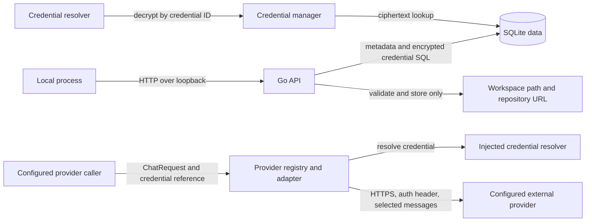

# boAIrd Threat Model

> This model distinguishes controls present in source from documented future goals. Threat rows describe plausible risks; they are not claims of confirmed vulnerabilities.

## 1. Current implementation and scope

boAIrd currently starts a local Go HTTP service with a SQLite database. The service exposes health/status endpoints, project create/list/read/update/archive operations, metadata-only credential management, and agent configuration create/list/read/update operations. The configured host must be a loopback IP address; the default is `127.0.0.1:3110`. Project rows may contain a name, description, Brain reference, workspace path, repository URL, lifecycle state, and human-review flag.

Provider-neutral request/model types, a registry, and adapters for OpenAI, Anthropic, DeepSeek, Gemini, and OpenAI-compatible APIs are implemented under `internal/provider`. Adapters resolve credentials through an injected `CredentialResolver`, use HTTPS by default (HTTP only for loopback), disable redirects, bound request/response sizes and request duration, and omit provider error bodies from returned HTTP errors. The application wires an encrypted credential vault and metadata-only credential-management API, but does not configure or call the provider registry. Credential ciphertext is stored in SQLite using AES-256-GCM with a deployment-supplied `BOAIRD_MASTER_KEY`; the key is not stored in the database. Structured logs redact sensitive attribute names and common bearer/provider token patterns.

Agent configuration validates runtime, provider/model/credential references, languages, instructions, and explicit capabilities. The `role` field is descriptive and does not grant capabilities. The application does not execute agents, tools, MCP sessions, or model-driven workflows. Brain, conversation, run, and task packages remain domain models without runtime composition. Project workspace paths and repository URLs are validated and persisted; the project API does not read workspace files, clone repositories, or fetch repository URLs. The API has no user authentication or authorization. Loopback binding prevents ordinary remote network access but does not isolate callers running on the same machine.

| Surface | Implemented behavior | Security boundary and limitation |
| --- | --- | --- |
| CLI and configuration | `boaird serve`; reads host/port/database settings and requires `BOAIRD_MASTER_KEY` as 64 hexadecimal characters. Host must parse as a loopback IP. | No authenticated remote mode. A same-host process can connect to the HTTP listener. |
| HTTP API | Health/status, project CRUD/archive, and credential create/list/delete. Credential responses contain only ID, name, and provider; request JSON is size-limited and rejects unknown fields. | No caller identity, authentication, or per-user authorization. Same-host processes can create, enumerate, or delete credentials through the unauthenticated listener. |
| Agent configuration | Agent create/list/read/update; role is descriptive, runtime status is read-only, and capabilities are stored only when explicitly supplied. API runtimes store a provider-matched credential ID. | Agent configuration does not execute code or authorize tools. Same-host callers can configure agents because the API has no authentication or per-user authorization. |
| SQLite | Opens/migrates the configured database; creates parent directories with mode `0700` and database file mode `0600`. Credential secrets are stored only as AES-256-GCM ciphertext; agent rows store provider configuration and credential IDs. | Permissions on a pre-existing parent directory are not changed. Local OS users with database access can read or replace ciphertext and metadata. |
| Project data | Validates project names, workspace paths, repository URL schemes, page limits, and Brain references; SQL uses parameters. | Workspace and repository values are stored, not acted upon by this API. No tenant boundary exists. |
| Provider adapters | Provider-specific chat/model requests; credential reference resolved immediately before each HTTP call; bounded JSON transport and sanitized HTTP status errors. | Adapters are not wired into `app.Run`. If called by another component, prompt/message content is sent to the configured provider. No context-selection policy or provider endpoint allowlist is implemented here. |
| MCP, tools, dashboard, audit | Present as design goals in repository documentation. | No executable MCP server, tool executor, browser dashboard, or durable audit pipeline is wired in the application. |

### Effective configuration and data locations

| Resource | Configuration | Current default or enforcement | Security notes |
| --- | --- | --- | --- |
| HTTP listener | `BOAIRD_HOST`, `BOAIRD_PORT` | `127.0.0.1:3110`; non-loopback IPs are rejected. | HTTP is used on loopback. There is no authentication, so local processes are within the current trust boundary. |
| SQLite database | `BOAIRD_DATABASE_PATH` | `./data/boaird.db`; newly created parent/file modes are `0700`/`0600`. | A caller may choose another path; existing parent-directory permissions and symlink ownership are not hardened by the current code. |
| Provider endpoint | `provider.Config.BaseURL` | Vendor HTTPS endpoint by default; custom HTTP endpoints are restricted to `localhost` or loopback IPs. | The configured HTTPS host is trusted by the caller; the adapter does not maintain a provider host allowlist. |
| Provider credential | `BOAIRD_MASTER_KEY` plus credential ID | Secret is encrypted at rest, resolved only on request, and returned by the credential API only as metadata. | Master key is held in process memory and supplied by deployment; key rotation and per-credential authorization are not implemented. |
| Workspace/repository metadata | Project API request fields | Workspace path must resolve to an existing directory; repository URL must use HTTP, HTTPS, or SSH. | Values are only stored today. Any later clone/read/write behavior needs a separate SSRF/path/authorization review. |

### Data flow

The credential resolver is available to the provider adapter packages, but those adapters are not connected to the running HTTP service or an agent runtime.

## 2. Assets, actors, and assumptions

### Assets

- Project names, descriptions, lifecycle state, Brain association, and configuration metadata stored in SQLite.
- Local database integrity and availability.
- Workspace path and repository URL metadata, which may reveal local layout or private repository locations.
- If provider adapters are used: credential values returned by the injected resolver, provider-bound message content, and provider responses.
- Assets not currently handled by the application: agent execution authority, MCP sessions, tool authority, audit records, and user/tenant data. Agent identity and configuration are persisted, while capability enforcement is not yet wired.

### Actors and capabilities

| Actor | Current capability | Not assumed |
| --- | --- | --- |
| Local user launching boAIrd | Selects environment configuration and database path; can stop or restart the process. | No remote administrator role is implemented. |
| Other process on the same host | Can attempt HTTP requests to the loopback listener. The API has no authentication layer. | It does not automatically have filesystem access to the SQLite file; OS permissions still apply. |
| Agent configuration caller | Can create and update agent configuration through the unauthenticated local API, including explicit capability labels. | A role label does not grant authority; capability enforcement and agent execution are not wired. |
| Remote network caller | Cannot directly reach the default listener through a non-loopback bind because configuration rejects non-loopback IPs. | No claim is made about host firewall, port forwarding, local proxies, or a separately exposed reverse proxy. |
| Provider caller/configuration owner | Chooses provider config and request messages, and supplies a resolver implementation. | The adapter itself does not select or filter project context and does not validate that a credential is authorized for a particular project. |
| Configured provider | Receives request messages and credentials in its required auth header when an adapter call is made. | No provider calls are made by the default application startup path. |
| Future MCP client, worker, or tool author | Would cross planned trust boundaries if those features are wired. | These actors have no current executable MCP, agent-runtime, or tool capability through this application. |

### Trust boundaries

1. **Local process to HTTP API.** The listener is loopback-only, but endpoints are unauthenticated. Other same-host processes are inside the effective network trust boundary.
2. **HTTP API to domain managers and SQLite.** Request decoding is bounded and rejects unknown JSON fields; domain validation and parameterized SQL protect input handling. Agent roles are descriptive, and stored capabilities are not enforced by an execution layer. There is no user/project ownership boundary.
3. **Provider adapter to credential resolver.** The adapter passes a credential reference to the injected resolver, then sends the returned value only in the provider auth header. The credential manager implements encrypted storage and resolution; scoped authorization, rotation, and caller identity are not implemented.
4. **Provider adapter to external host.** HTTPS is required except for loopback development endpoints. Redirects are not followed, and error response bodies are not returned. Custom HTTPS base URLs remain caller-trusted, so a party controlling provider configuration can select the recipient host.
5. **Project metadata to filesystem or Git.** The current API validates and persists these strings but performs no filesystem operation, clone, DNS lookup, or network fetch based on the repository URL.
6. **Credential, agent, and provider boundary.** Credential and agent configuration APIs are wired, but agent/provider execution is not connected to app runtime. Provider endpoint selection, scoped authorization, key rotation, capability enforcement, and durable audit remain future boundaries.

## 3. Threat scenarios and mitigations

These are hypotheses to guide implementation and review. Priority reflects potential impact if prerequisites are met.

| Priority | Scenario and impact | Prerequisites | Current controls and limits | Mitigation / follow-up |
| --- | --- | --- | --- | --- |
| P1 | **Same-host unauthenticated project access:** another local process reads or changes projects through the loopback API. | Attacker can run code on the host and reach the listener. | Non-loopback bind is rejected; request size and project validation are enforced. There is no authentication or authorization, so loopback is not a per-user boundary. | Add local authentication/authorization before treating multiple OS users or untrusted local processes as isolated; test unauthorized read and mutation paths. |
| P1 | **Provider credential disclosure or misuse:** a credential reaches an unintended host, log, or caller, or is used outside its intended project. | A same-host caller accesses the unauthenticated credential API, the master key is exposed, or a provider adapter is invoked with compromised configuration. | AES-256-GCM with per-record random nonce and ID/provider authenticated data; ciphertext-only persistence; metadata-only API responses; structured log redaction; provider transport blocks redirects. Same-host callers are not authenticated; resolver authorization, key rotation, and provider host policy are absent. | Add local caller authentication/authorization before treating same-host processes as isolated; define key rotation, credential scopes and audit; keep credentials out of URLs and agent-visible data. |
| P1 | **Sensitive prompt/context disclosure to a provider:** project or workspace content is sent externally without approval. | A caller passes sensitive content to an adapter and invokes a configured provider. | The transport sends the supplied messages; current app startup does not invoke adapters. No context-selection or consent policy is implemented. | Add explicit provider/data-use policy and context minimization before wiring providers into runtime; surface the destination and data classes to the user. |
| P2 | **Provider endpoint misuse / SSRF:** a malicious or mistaken config points a provider adapter at an unintended HTTPS endpoint. | A component accepts attacker-controlled `BaseURL` and calls an adapter. | HTTPS is required except loopback HTTP; URLs with userinfo/query/fragment or traversal paths are rejected; redirects are not followed. Arbitrary HTTPS hosts are otherwise allowed. | Restrict configuration to administrator-controlled provider endpoints or an allowlist; consider DNS/IP policy if untrusted users can configure endpoints. |
| P2 | **Project metadata becomes an unsafe file or network operation:** a later feature reads a stored workspace path or fetches a repository URL without revalidation. | A later agent/runtime feature consumes project metadata. | Workspace paths are canonicalized to existing directories and repository URLs are scheme-checked at storage time. The current API does not access these locations. | Revalidate at use time, enforce workspace roots and symlink policy, and restrict outbound Git/network destinations before adding clone or file operations. |
| P2 | **SQLite disclosure or tampering:** another local account reads or replaces project data. | Attacker can access the database path or parent directory under OS permissions. | Newly created database directories/files use restrictive modes. Existing parent permissions, symlink ownership, backups, and filesystem-level access are not managed here. | Document secure placement and backup permissions; harden symlink and existing-directory handling if the local threat model includes other OS users. |
| P2 | **Future MCP/tool authority confusion:** a client or prompt-injection payload obtains project or host operations beyond its grant. | MCP sessions or tool execution are implemented and reachable. | No MCP server or tool executor is wired in the current application. | Bind each action to authenticated identity, project, and capability; reauthorize on the backend; treat repository/provider content as untrusted. |
| P2 | **Future audit omission:** a sensitive mutation occurs without durable attribution. | Sensitive actions and audit persistence are implemented. | Project mutations are persisted, but there is no durable audit pipeline in the application bootstrap. | Add durable actor/resource/outcome events and define behavior when audit persistence fails before introducing privileged runtime actions. |

## 4. Verification evidence and scope limits

The source inventory for this model includes the executable and configuration under `cmd/boaird` and `internal/config`, HTTP routing under `internal/api`, project, agent, and credential services, SQLite access under `internal/storage`, structured log redaction under `internal/logging`, and provider contracts/adapters under `internal/provider`. The runtime composition in `internal/app` wires project, agent, and credential managers to SQLite; provider adapters, Brain runtime, MCP, and tools are not wired.

The source-backed controls described here should be rechecked when code or deployment configuration changes. This model is not a complete security audit, does not establish the safety of the host deployment, and does not claim that tests prove upstream provider behavior. Future remote access, provider runtime, MCP, tool execution, user isolation, key rotation, or audit implementation requires a fresh threat-model review.
