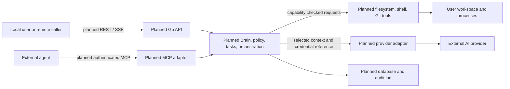

# boAIrd Threat Model

> Repository-wide architecture model for the checked-in source at the revision recorded below. Attack scenarios are hypotheses for future implementation and are not confirmed vulnerabilities.

## 1. Overview

### Intended use and current implementation

boAIrd is described as a local-first control plane for AI agents, with a Go core, dashboard, REST/SSE, MCP, providers, tools, project state, and optional remote deployment (README.md:3-27; ARCHITECTURE.md:127-209). These are intended design surfaces. In the inspected revision, the executable entry point only prints a fixed startup message; the four internal Go packages contain only package declarations (cmd/boaird/main.go:1-7; internal/agent/agent.go:1; internal/orchestrator/orchestrator.go:1; internal/provider/provider.go:1; internal/task/task.go:1). There is no implemented server, MCP transport, provider request, database access, credential handling, tool execution, or audit path in this source inventory.

| Component or surface | Current evidence | Security relevance |
| --- | --- | --- |
| CLI entry point | `main` writes a constant to stdout (cmd/boaird/main.go:3-7). | Current runtime boundary is the invoking process and its terminal. |
| Agent, orchestration, provider, and task packages | Empty package stubs (internal/agent/agent.go:1; internal/orchestrator/orchestrator.go:1; internal/provider/provider.go:1; internal/task/task.go:1). | No runtime authority or controls are established by these packages. |
| Dashboard and REST/SSE | Described as a browser-to-Go-core design (ARCHITECTURE.md:167-209). | Planned interface; no listener or browser application is present in the tracked source inventory. |
| MCP and external agents | Described as external clients connected through MCP to identity and services (ARCHITECTURE.md:557-584, 1659-1685). | Planned trust boundary; no MCP server or session implementation is present. |
| Providers and credentials | Provider runtime and credential flow are described in architecture (ARCHITECTURE.md:529-553, 616-688). | Planned external data transfer and secret boundary; no implementation is present. |
| Local tools and workspace | Filesystem and shell tools are proposed (ARCHITECTURE.md:1280-1349). | Planned access to user files and processes; no tool registry or executor is present. |
| Persistence and audit | SQLite and audit are described by policy and architecture (SECURITY.md:2024-2040; ARCHITECTURE.md:1829-1850). | Planned sensitive state; no database or audit writer is present in the tracked source inventory. |

### Effective resources and deployment

The rows below distinguish effective behavior from documented target behavior. The source inventory for this revision is the tracked Go entry point, four package stubs, and `go.mod` (go.mod:1-3; the files cited above).

| Deployment or workflow | Resource or capability | Configuration and precedence | Safe effective value or location | Readers, writers, or recipients | Enforcing control | Evidence or unknowns |
| --- | --- | --- | --- | --- | --- | --- |
| Current executable | stdout | No configuration is read; the entry point calls `fmt.Println` with a constant. | Fixed, nonsensitive startup text. | Invoking process's stdout consumer, usually the terminal. | No sensitive operation is performed on this path. | cmd/boaird/main.go:3-7 |
| Documented local mode (not implemented) | HTTP/API listener and dashboard | README gives `boaird serve` and `http://localhost:3110`; SECURITY requires loopback by default. No listener or setting consumer exists. | No effective bind address or port is established. | No runtime client is established; docs describe a browser. | Loopback is a policy requirement, not an implemented control. | README.md:121-135; SECURITY.md:1040-1068; cmd/boaird/main.go:3-7 |
| Documented remote mode (conditional, not implemented) | Remote API and dashboard | README gives an HTTPS example and says remote hosting may be supported later; SECURITY requires authentication, TLS, and authorization. | No effective endpoint, TLS configuration, or authentication setting is established. | No runtime recipient is established. | Requirements are documented only. | README.md:139-153; SECURITY.md:1072-1082; cmd/boaird/main.go:3-7 |
| Documented provider flow (conditional, not implemented) | Provider requests and credentials | Architecture describes Agent → API Runtime → Provider Registry → Provider; no provider or credential consumer exists. | No endpoint, credential reference, or secret storage location is consumed. | No external provider recipient is established. | Isolation and secret protection are policy/design goals only. | ARCHITECTURE.md:529-553, 616-688; internal/provider/provider.go:1 |
| Documented storage (conditional, not implemented) | SQLite project/task state | SECURITY names `data/boaird.db`; no database dependency, migration, or path consumer is in the tracked source inventory. | No database path is consumed. | No database reader or writer is established. | File permissions and parameterized queries are requirements only. | SECURITY.md:2024-2040; go.mod:1-3 |
| Documented local tools (conditional, not implemented) | Filesystem, shell, Git, and GitHub operations | Architecture lists tool types and workspace limits; there is no executor or workspace configuration consumer. | No workspace root, executable, repository target, or derived path is consumed. | No operating-system or repository resource consumer is established. | Capability checks and workspace confinement are requirements only. | ARCHITECTURE.md:1280-1349; SECURITY.md:545-610 |
| Documented MCP flow (conditional, not implemented) | MCP transport, sessions, and external-agent identity | Architecture describes transport → session → identity → services; there is no MCP implementation or auth setting consumer. | No endpoint, session store, or credential is consumed. | No connected client is established. | Authentication and capability rules are documented only. | ARCHITECTURE.md:557-584, 1659-1685; SECURITY.md:1106-1160 |

### Intended data flow

The following diagram summarizes documented future architecture, not current runtime components.

## 2. Threat Model, Trust Boundaries, and Assumptions

### Protected assets and objectives

Current executable behavior has no sensitive asset beyond runtime integrity and the local terminal output. For the documented design, assets that would need protection include project and task state, agent identities and capabilities, workspace contents, credentials, provider-bound context, and audit records (SECURITY.md:206-220, 807-902, 1644-1732; ARCHITECTURE.md:260-270, 1093-1112). Their presence or access is not established in current executable code.

Security objectives for a future implementation, taken from the repository policy, are:

- Keep administrator and project policy authority above Brain, agent, and worker requests; check capabilities in the backend and deny by default (SECURITY.md:57-80, 249-299).
- Authenticate remote API and MCP clients, enforce authorization server-side, and do not expose network services by default (SECURITY.md:1040-1082, 1106-1160).
- Confine filesystem and process operations to approved workspaces and capabilities; never execute raw model output (SECURITY.md:416-610, 1312-1348).
- Keep raw credentials away from agents and logs, redact secrets, and limit provider context to approved data (SECURITY.md:807-902, 1918-1948).
- Preserve attributable audit events for sensitive actions and fail closed when policy or authorization cannot be determined (SECURITY.md:1644-1732, 1760-1800).

These are design objectives, not controls verified in the current implementation.

### Actors and starting capabilities

| Actor | Current or conditional starting capability | Privileges not assumed |
| --- | --- | --- |
| Local invoker | Can run the current entry point and read its fixed stdout output (cmd/boaird/main.go:3-7). | No server, agent, credential, database, or tool access is established. |
| Local user or project administrator | Would configure projects and authorize work in the documented design (SECURITY.md:114-130; ARCHITECTURE.md:239-309). | No implemented identity or authorization model is present. |
| Remote API caller | Conditional on a future remote deployment. | No internet exposure, tenant model, or remote endpoint is established (README.md:139-153). |
| MCP client or external agent | Would send requests across the documented MCP boundary (ARCHITECTURE.md:557-584, 1659-1685). | No connected client or authenticated session is established. |
| Prompt-injection content author | Could supply hostile repository, task, or provider content only if the future system ingests such content. | No content ingestion or agent execution path exists in the inspected source. |
| External provider | Could receive selected context only if provider calls are implemented and configured (ARCHITECTURE.md:529-553). | No provider call or credential recipient is established. |
| Dependency or build publisher | Could affect released artifacts only through future dependency/build workflows. | No CI workflow, release process, or dependency beyond the Go module declaration is established by the tracked inventory (go.mod:1-3). |

### Trust boundaries and assumptions

1. **Current process to terminal.** `main` writes one fixed string to stdout. No input, secret, or authority crosses this boundary (cmd/boaird/main.go:3-7).
2. **Browser or remote caller to API.** This is a documented future interface. Loopback is the stated local default; remote mode is expected to require authentication, TLS, and authorization, but none is implemented or effective in this revision (ARCHITECTURE.md:167-209; SECURITY.md:1040-1082).
3. **External MCP client to boAIrd services.** The intended flow crosses transport, session, identity, and services. The policy says connection alone must grant no capabilities and remote MCP requires authentication; there is no source-backed enforcement today (ARCHITECTURE.md:1659-1685; SECURITY.md:1106-1160).
4. **Brain to specialized agents and workers.** The design gives the Brain operational authority, while administrator policy remains higher and workers/agents should act only within assigned capabilities. Task review can flow from Worker through Reviewer/Brain and optionally a human (ARCHITECTURE.md:332-387, 830-903; SECURITY.md:57-80, 131-172, 176-202). These are policy boundaries only; no Brain, worker, task, or permission code exists in this revision (internal/agent/agent.go:1; internal/orchestrator/orchestrator.go:1; internal/task/task.go:1).
5. **Agent/runtime to provider.** The intended flow can transfer selected context to an external provider. No provider, credential service, or context filtering path exists in the inspected implementation (ARCHITECTURE.md:529-553, 616-688; internal/provider/provider.go:1).
6. **Agent/runtime to local tools.** Filesystem and shell operations could affect workspace files or processes. Policy describes capability checks and workspace boundaries, but no executor or effective workspace root exists (ARCHITECTURE.md:1280-1349; SECURITY.md:545-610).
7. **Application to persistence and audit.** A SQLite location and audit behavior are documented, but no database or audit consumer exists in this source inventory (SECURITY.md:1644-1732, 2024-2040).

Assumptions and scope limits:

- This model covers the checked-in source at the revision below. Current tracked files contain a Go module, the command entry point, and four one-line internal package stubs; documentation describes a broader intended product (go.mod:1-3; cmd/boaird/main.go:1-7; internal/agent/agent.go:1; internal/orchestrator/orchestrator.go:1; internal/provider/provider.go:1; internal/task/task.go:1).
- Documentation is not proof of a command, service, deployment, control, secret, or data store. For example, README's `boaird serve` command and localhost URL are examples; current `main` only prints a message (README.md:121-135; cmd/boaird/main.go:3-7).
- The security policy is normative. Its requirements for loopback binding, authentication, MCP identity, workspace controls, secrets, and audit are not runtime guarantees until implemented and verified (SECURITY.md:1040-1082, 1106-1160, 807-902, 1644-1732).
- Remote access, multiple users, tenant isolation, active agents, credentials, persistent user data, and external provider traffic are not established. Scenarios involving these require the stated future component and deployment prerequisite.
- This is architecture mapping, not a vulnerability audit or finding report. Absence of implementation means future-boundary scenarios remain conditional; it does not establish a vulnerability in code that is not present.

## 3. Attack Surface, Mitigations, and Attacker Stories

Each row is a **hypothesis**, not a confirmed vulnerability. Priority ranks the design work by potential impact and exposure if the documented component is implemented.

| Priority | Scenario and capability gain | Prerequisites | Impact | Existing controls | Mitigation | Evidence |
| --- | --- | --- | --- | --- | --- | --- |
| P1 | **Remote API authorization bypass:** a remote caller reaches project/task operations without an authenticated identity or server-side authorization, gaining access to or control over another user's project. | Remote API implemented and reachable; caller can reach endpoint; authorization missing or bypassable. | Project data disclosure or unauthorized state changes. | Policy requires authentication, TLS, and authorization for remote mode; no API code exists to enforce it. | Keep remote mode disabled until authentication, object-level authorization, TLS termination/configuration, and negative access tests are implemented; bind local mode to loopback. | README.md:139-153; ARCHITECTURE.md:167-209; SECURITY.md:1040-1082; cmd/boaird/main.go:3-7 |
| P1 | **MCP identity or capability confusion:** an external MCP client reuses or forges session identity, or receives tools beyond its grant, gaining project actions as another agent. | MCP server and stateful sessions implemented; attacker can connect or influence session credentials; identity/capability checks fail. | Unauthorized project access or tool invocation. | Policy treats MCP as a trust boundary, requires remote authentication, identity, and explicit capabilities; not implemented. | Bind every request to authenticated client, project, session, and capability on the server; reject stale or mismatched identities and default to no tools. | ARCHITECTURE.md:557-584, 1659-1685; SECURITY.md:1106-1160 |
| P1 | **Tool boundary escape:** hostile task or model content induces a filesystem or shell tool to read/write outside the approved workspace or execute an unintended command, gaining host-level file or process authority. | Tool execution implemented; attacker controls content reaching agent; unsafe path or command handling. | Workspace disclosure, modification, deletion, or process execution. | Policy identifies shell as high risk, calls for workspace boundaries and rejects raw model output; no executor exists. | Enforce capabilities and canonical path boundaries in the backend, defend against traversal and symlinks, use constrained commands, and require human approval for critical actions. | ARCHITECTURE.md:1280-1349; SECURITY.md:416-610, 1312-1348 |
| P1 | **Credential exposure through provider context or logs:** a provider integration passes raw credentials or excessive project context to an agent, external provider, or log, granting unauthorized use or disclosure. | Provider and credential flow implemented; credentials/context available; filtering or redaction fails. | Provider account abuse, secret compromise, or project data disclosure. | Policy calls for credential isolation, redaction, and data minimization; no provider or credential consumer exists. | Pass credential references to a trusted broker, inject secrets only at the provider adapter, redact outputs, and let users review provider data handling and context selection. | ARCHITECTURE.md:529-553, 616-688; SECURITY.md:807-902, 1918-1948 |
| P2 | **Brain/worker authority escalation:** a worker's output or request is treated as authority to change policy, grant capabilities, replace the Brain, or skip required review, gaining administrative or tool privileges. | Brain/worker workflow implemented; attacker can influence a worker or its output; backend confuses operational requests with administrator authority. | Privilege escalation, unauthorized tool use, or unreviewed project changes. | Policy separates administrator and Brain authority, denies by default, and calls for backend capability checks; these are not implemented in current code. | Enforce the authority hierarchy in backend services, bind requests to task and agent identity, require administrator approval for policy changes, and test worker-to-privileged-operation rejection. | ARCHITECTURE.md:332-387, 830-903; SECURITY.md:57-80, 131-172, 249-310 |
| P2 | **Prompt injection crosses policy boundary:** hostile repository, task, or provider text is treated as instruction and causes the Brain/agent to request unauthorized tools or disclose context. | Context ingestion and model execution implemented; attacker can supply content included in context; policy is not independently enforced. | Unauthorized tool request or disclosure of data already available to the agent. | Policy classifies external content as untrusted and requires backend authorization for tool calls; no ingestion/runtime path exists. | Preserve source trust labels, separate policy from content, minimize context, and re-authorize every operation in a deterministic backend policy layer. | SECURITY.md:1225-1348, 1439-1452; ARCHITECTURE.md:1404-1476 |
| P2 | **Project/task state tampering or injection:** crafted API or MCP input changes task ownership, project identity, or workflow state without validation or ownership checks. | Persistence and mutation endpoints implemented; attacker can submit malformed or cross-project identifiers. | Unauthorized state transition, work disclosure, or unsafe downstream execution. | Policy and architecture describe project scoping, validation, and human review; no storage or endpoint implementation exists. | Validate typed inputs, enforce project ownership and allowed state transitions in domain services, use parameterized database queries, and audit privileged transitions. | ARCHITECTURE.md:276-309, 717-865; SECURITY.md:954-976, 2024-2040 |
| P2 | **Audit record omission or tampering:** a privileged operation succeeds without a durable audit record, leaving operators unable to attribute or investigate it. | Sensitive operations and audit storage implemented; attacker can trigger actions or alter the audit store. | Reduced detection and incident reconstruction; concealment of unauthorized actions. | Policy calls for audit events and immutability; no audit implementation or storage exists. | Make security-relevant mutations and audit writes atomic where possible, restrict audit modification, include actor/resource/outcome, and alert on audit failure. | ARCHITECTURE.md:1829-1850; SECURITY.md:1644-1732 |
| P2 | **Dependency or build artifact substitution:** a compromised dependency or release workflow ships altered code with the application's future tool or credential authority. | Build/release workflow and dependency resolution implemented; attacker controls a dependency source or release credential. | Shipped code may inherit all local application privileges. | No workflow or lockfile is in the tracked source inventory; policy sets supply-chain expectations but does not establish controls. | Pin and review dependencies, protect release credentials, produce verifiable build provenance, and review changes to privileged code paths. | go.mod:1-3; SECURITY.md:1541-1628 |

## 4. Severity Calibration (Critical, High, Medium, Low)

Severity depends on reachable impact, required attacker capability, and effective controls. The scenarios above have no confirmed severity because their prerequisites are not implemented or established in this revision.

| Severity | Example if the relevant component is implemented | Counterexample or lowering condition |
| --- | --- | --- |
| Critical | Unauthenticated remote execution of arbitrary commands across projects or users, with broad host or tenant impact and no effective containment. | No remote listener or command executor exists in the inspected source, so this example is not a current finding. An operation confined to an attacker's own project is not automatically critical. |
| High | A reachable remote or MCP authorization failure exposes or modifies other users' sensitive project data, or a tool escape grants broad host access. | Requires the relevant interface, reachable deployment, sensitive resources, and bypassable enforcement. Documentation examples do not establish exposure. |
| Medium | A constrained cross-project task mutation or limited context disclosure occurs behind an implemented interface with partial containment. | A malformed request rejected before sensitive state changes, or a prompt injection whose tool request is denied by backend policy, does not establish impact. |
| Low | A narrow, low-sensitivity metadata disclosure or audit gap has limited reach and no meaningful privilege gain. | Ordinary authorized behavior, self-only effects, or disclosure of already-public data is not a security impact without additional consequences. |

Do not assign severity from a feature description alone. Reassess this model when executable API, MCP, provider, persistence, audit, or tool code is added, and inspect the actual deployment configuration and effective resource paths at that time.

Repository: sha256:662b04633a1c714e9ae82c7da08e070c8a551b9dab68442149845683ae73904a
Version: a95983be06ed266b3a3ed2e74b74825839610492
