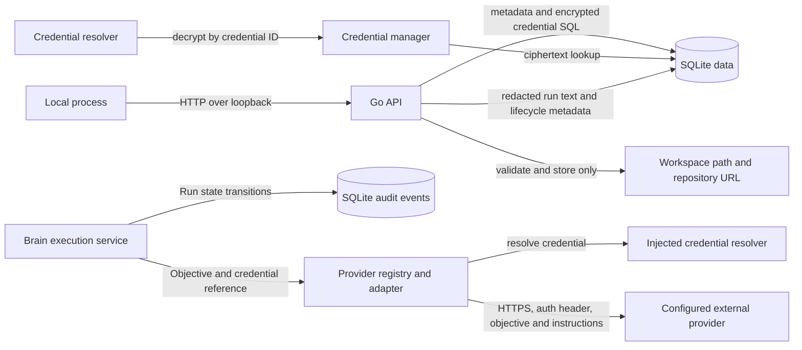

# boAIrd Threat Model

> This model distinguishes controls present in source from documented future goals. Threat rows describe plausible risks; they are not claims of confirmed vulnerabilities.

## 1. Current implementation and scope

boAIrd currently starts a local Go HTTP service with a SQLite database. The service exposes health/status endpoints, project create/list/read/update/archive operations, metadata-only credential management, agent configuration create/list/read/update operations, Brain execution and run history, and Kanban task create/list/read/assign/transition operations. The configured host must be a loopback IP address; the default is `127.0.0.1:3110`. Project rows may contain a name, description, Brain reference, workspace path, repository URL, lifecycle state, and human-review flag.

Provider-neutral request/model types, a registry, and adapters for OpenAI, Anthropic, DeepSeek, Gemini, and OpenAI-compatible APIs are implemented under `internal/provider`. Adapters resolve credentials through an injected `CredentialResolver`, use HTTPS by default (HTTP only for loopback), disable redirects, bound request/response sizes and request duration, and omit provider error bodies from returned HTTP errors. The application configures the provider registry for Brain execution on demand. Credential ciphertext is stored in SQLite using AES-256-GCM with a deployment-supplied `BOAIRD_MASTER_KEY`; the key is not stored in the database. Conversation routes require a separate `BOAIRD_LOCAL_AUTH_TOKEN`, which authenticates the single `local-administrator` principal and is compared in constant time. Structured logs redact sensitive attribute names and common bearer/provider token patterns.

Agent configuration validates runtime, provider/model/credential references, languages, instructions, and explicit capabilities. The `role` field is descriptive and does not grant capabilities. Projects can attach one active Brain to an API agent with the explicit `brain.execute` capability. Brain objectives invoke the configured provider and persist a Run. The current Brain returns proposed plan text and does not mutate tasks or project policy, expose raw credentials, change capabilities, replace itself, or bypass human review. The task service persists tasks, checks workflow transitions and agent capabilities for creation/assignment, applies project human-review policy, and records immutable audit events for creation, assignment, and status changes. Conversations are stored per task; agent messages require assignment to that task and Brain messages require the project's active Brain. Human conversation reads/writes require the configured local bearer token and a `project_members` row; new projects and existing projects are assigned to the single local administrator. Message history is bounded and cursor-paginated. Message content and metadata are redacted before persistence. Caller-supplied sender identity is rejected. Agent execution, tools, and MCP sessions are not wired. Project workspace paths and repository URLs are validated and persisted; the project API does not read workspace files, clone repositories, or fetch repository URLs. Other HTTP API routes remain unauthenticated and available to same-host callers; loopback binding prevents ordinary remote network access but does not isolate local processes.

| Surface | Implemented behavior | Security boundary and limitation |
| --- | --- | --- |
| CLI and configuration | `boaird serve`; reads host/port/database settings and requires `BOAIRD_MASTER_KEY` and `BOAIRD_LOCAL_AUTH_TOKEN` as 64 hexadecimal characters. Host must parse as a loopback IP. | No authenticated remote mode. Most routes remain unauthenticated; conversation routes require the token. |
| HTTP API | Health/status, project CRUD/archive, credential create/list/delete, agent configuration, Brain execution/run history, task workflow, and task conversation endpoints. Credential responses contain only ID, name, and provider; request JSON is size-limited and rejects unknown fields. Task mutation requests require a reason and actor identity is fixed by the server. Conversation routes authenticate the local administrator and check project membership. | Same-host processes retain local API authority for all non-conversation routes, including task management and credential operations. The single-principal membership model is not multi-user identity management. |
| Agent configuration | Agent create/list/read/update; role is descriptive, runtime status is read-only, and capabilities are stored only when explicitly supplied. API runtimes store a provider-matched credential ID. | Same-host callers can configure agents because the API has no authentication or per-user authorization. |
| Brain and runs | Project Brain attach/read and objective execution; only API agents with `brain.execute` may be attached; provider output and run state are persisted; autonomy does not grant capability. | The Brain returns proposed text only. No tool or task mutation is exposed. The API remains unauthenticated to local processes, and provider-bound objectives/responses may contain sensitive data. |
| Run history and audit | Run input/output/tool/error text is redacted for common secret patterns before persistence and display. SQLite creates immutable audit rows for Run creation and status changes; project history filters by task and agent. | Redaction is pattern-based and cannot identify every secret format. Run content is stored as plaintext in SQLite after redaction. SQL triggers protect audit rows from application updates/deletes but do not protect against an OS user who can directly alter the database file. |
| Task workflow and audit | Backend validates task state transitions, rejects worker task creation by default, checks explicit capabilities for Brain/agent actions, applies human-review policy, and stores actor/reason on mutations. SQLite records immutable creation, assignment, and status events. | The unauthenticated local API uses a fixed management actor, so any same-host process can perform these operations. Audit triggers do not protect against an OS user who can alter the SQLite database or schema directly. |
| Task conversations | Every task has one persisted conversation. Messages store opaque content, content type, JSON metadata, sender identity, and timestamp. The HTTP API requires a configured bearer token and project membership for human reads/writes; agent/Brain sender identities are checked against task assignment or the active project Brain. History is cursor-paginated and content is redacted. | The token maps to one configured local administrator, not individual human accounts. Other API routes remain unauthenticated. Redaction is pattern-based and cannot identify every secret. Conversation rows are not protected by immutable audit events. |
| SQLite | Opens/migrates the configured database; creates parent directories with mode `0700` and database file mode `0600`. Credential secrets are stored only as AES-256-GCM ciphertext; agent rows store provider configuration and credential IDs. | Permissions on a pre-existing parent directory are not changed. Local OS users with database access can read or replace ciphertext and metadata. |
| Project data | Validates project names, workspace paths, repository URL schemes, page limits, and Brain references; SQL uses parameters. | Workspace and repository values are stored, not acted upon by this API. No tenant boundary exists. |
| Provider adapters | Provider-specific chat/model requests; credential reference resolved immediately before each HTTP call; bounded JSON transport and sanitized HTTP status errors. The Brain runtime invokes chat on demand. | Prompt objectives and Brain instructions are sent to the configured provider. No context-selection/consent policy or provider endpoint allowlist is implemented here. |
| MCP, tools, dashboard, general audit | Present as design goals in repository documentation. | No executable MCP server, tool executor, or browser dashboard is wired in the application. Project/agent/credential mutations do not yet have general audit coverage; Run and task lifecycle events are audited. |

### Effective configuration and data locations

| Resource | Configuration | Current default or enforcement | Security notes |
| --- | --- | --- | --- |
| HTTP listener | `BOAIRD_HOST`, `BOAIRD_PORT` | `127.0.0.1:3110`; non-loopback IPs are rejected. | HTTP is used on loopback. Only conversation routes authenticate; local processes remain within the trust boundary for other APIs. |
| Conversation identity | `BOAIRD_LOCAL_AUTH_TOKEN` | Required 32-byte bearer token encoded as 64 hexadecimal characters; maps to `local-administrator`. | Keep separate from `BOAIRD_MASTER_KEY`. Token rotation requires updating the environment and restarting the process. |
| SQLite database | `BOAIRD_DATABASE_PATH` | `./data/boaird.db`; newly created parent/file modes are `0700`/`0600`. | A caller may choose another path; existing parent-directory permissions and symlink ownership are not hardened by the current code. |
| Provider endpoint | `provider.Config.BaseURL` | Vendor HTTPS endpoint by default; custom HTTP endpoints are restricted to `localhost` or loopback IPs. | The configured HTTPS host is trusted by the caller; the adapter does not maintain a provider host allowlist. |
| Provider credential | `BOAIRD_MASTER_KEY` plus credential ID | Secret is encrypted at rest, resolved only on request, and returned by the credential API only as metadata. | Master key is held in process memory and supplied by deployment; key rotation and per-credential authorization are not implemented. |
| Workspace/repository metadata | Project API request fields | Workspace path must resolve to an existing directory; repository URL must use HTTP, HTTPS, or SSH. | Values are only stored today. Any later clone/read/write behavior needs a separate SSRF/path/authorization review. |

### Data flow

The Brain runtime uses the provider adapters when an objective is submitted. Run records and lifecycle audit events are persisted by SQLite. Other agent runtimes and tool execution are not connected to the running HTTP service.

## 2. Assets, actors, and assumptions

### Assets

- Project names, descriptions, lifecycle state, Brain association, and configuration metadata stored in SQLite.
- Local database integrity and availability.
- Workspace path and repository URL metadata, which may reveal local layout or private repository locations.
- Provider credentials resolved for Brain calls, provider-bound objectives/instructions, provider responses, persisted Run text, and Run lifecycle audit events.
- Assets not currently handled by the application: general agent execution authority, MCP sessions, tool authority, audit records for non-Run mutations, and user/tenant data. Agent roles remain descriptive; Brain execution requires the explicit capability.

### Actors and capabilities

| Actor | Current capability | Not assumed |
| --- | --- | --- |
| Local user launching boAIrd | Selects environment configuration and database path; can stop or restart the process. | No remote administrator role is implemented. |
| Other process on the same host | Can attempt HTTP requests to the loopback listener. The API has no authentication layer. | It does not automatically have filesystem access to the SQLite file; OS permissions still apply. |
| Agent configuration caller | Can create and update agent configuration through the unauthenticated local API, including explicit capability labels. | A role label does not grant authority. Brain execution requires `brain.execute` and returns proposed text without tools or project mutations. |
| Remote network caller | Cannot directly reach the default listener through a non-loopback bind because configuration rejects non-loopback IPs. | No claim is made about host firewall, port forwarding, local proxies, or a separately exposed reverse proxy. |
| Provider configuration owner | Chooses provider configuration and Brain instructions through the local API. | The adapter does not select or filter project context or validate that a credential is authorized for a particular project. |
| Configured provider | Receives Brain objectives/instructions and its credential in the required auth header when a Brain run is requested. | The service does not automatically call providers at startup. |
| Future MCP client, worker, or tool author | Would cross planned trust boundaries if those features are wired. | These actors have no current executable MCP, agent-runtime, or tool capability through this application. |

### Trust boundaries

1. **Local process to HTTP API.** The listener is loopback-only. Conversation routes require the configured local bearer token and project membership. Other same-host processes remain inside the trust boundary for the other unauthenticated API routes.
2. **HTTP API to domain managers and SQLite.** Request decoding is bounded and rejects unknown JSON fields; domain validation and parameterized SQL protect input handling. Brain execution requires explicit `brain.execute`, and autonomy mode does not add permissions. There is no user/project ownership boundary, so same-host callers can configure a Brain and trigger provider usage.
3. **Provider adapter to credential resolver.** The adapter passes a credential reference to the injected resolver, then sends the returned value only in the provider auth header. The credential manager implements encrypted storage and resolution; scoped authorization, rotation, and caller identity are not implemented.
4. **Provider adapter to external host.** HTTPS is required except for loopback development endpoints. Redirects are not followed, and error response bodies are not returned. Custom HTTPS base URLs remain caller-trusted, so a party controlling provider configuration can select the recipient host.
5. **Project metadata to filesystem or Git.** The current API validates and persists these strings but performs no filesystem operation, clone, DNS lookup, or network fetch based on the repository URL.
6. **Credential, agent, and provider boundary.** Brain runs resolve a stored credential by ID and pass it to the provider adapter; provider error bodies are not stored, and common credential forms are redacted from run text. Pattern-based redaction is incomplete and Run content remains readable from the local database. Provider endpoint selection, scoped authorization, key rotation, Brain run quotas, and audit for other resource mutations remain future boundaries.

## 3. Threat scenarios and mitigations

These are hypotheses to guide implementation and review. Priority reflects potential impact if prerequisites are met.

| Priority | Scenario and impact | Prerequisites | Current controls and limits | Mitigation / follow-up |
| --- | --- | --- | --- | --- |
| P1 | **Same-host unauthenticated project access:** another local process reads or changes projects through the loopback API. | Attacker can run code on the host and reach the listener. | Non-loopback bind is rejected; request size and project validation are enforced. There is no authentication or authorization, so loopback is not a per-user boundary. | Add local authentication/authorization before treating multiple OS users or untrusted local processes as isolated; test unauthorized read and mutation paths. |
| P1 | **Provider credential disclosure or misuse:** a credential reaches an unintended host, log, or caller, or is used outside its intended project. | A same-host caller accesses the unauthenticated credential API, the master key is exposed, or a provider adapter is invoked with compromised configuration. | AES-256-GCM with per-record random nonce and ID/provider authenticated data; ciphertext-only persistence; metadata-only API responses; structured log redaction; provider transport blocks redirects. Same-host callers are not authenticated; resolver authorization, key rotation, and provider host policy are absent. | Add local caller authentication/authorization before treating same-host processes as isolated; define key rotation, credential scopes and audit; keep credentials out of URLs and agent-visible data. |
| P1 | **Sensitive prompt/context disclosure to a provider:** project or workspace content is sent externally without approval. | A same-host caller submits an objective or configures agent instructions and triggers a Brain run. | Brain sends the objective and configured instructions to the selected provider. The current runtime does not read workspace contents, and provider transport protects credentials and sanitizes errors. No consent or context-selection policy is implemented. | Add explicit provider/data-use policy, objective limits, and context minimization; surface the destination and data classes before remote or multi-user use. |
| P2 | **Provider endpoint misuse / SSRF:** a malicious or mistaken config points a provider adapter at an unintended HTTPS endpoint. | A component accepts attacker-controlled `BaseURL` and calls an adapter. | HTTPS is required except loopback HTTP; URLs with userinfo/query/fragment or traversal paths are rejected; redirects are not followed. Arbitrary HTTPS hosts are otherwise allowed. | Restrict configuration to administrator-controlled provider endpoints or an allowlist; consider DNS/IP policy if untrusted users can configure endpoints. |
| P2 | **Project metadata becomes an unsafe file or network operation:** a later feature reads a stored workspace path or fetches a repository URL without revalidation. | A later agent/runtime feature consumes project metadata. | Workspace paths are canonicalized to existing directories and repository URLs are scheme-checked at storage time. The current API does not access these locations. | Revalidate at use time, enforce workspace roots and symlink policy, and restrict outbound Git/network destinations before adding clone or file operations. |
| P2 | **SQLite disclosure or tampering:** another local account reads or replaces project data. | Attacker can access the database path or parent directory under OS permissions. | Newly created database directories/files use restrictive modes. Existing parent permissions, symlink ownership, backups, and filesystem-level access are not managed here. | Document secure placement and backup permissions; harden symlink and existing-directory handling if the local threat model includes other OS users. |
| P1 | **Unauthenticated local caller consumes provider quota:** a local process repeatedly submits objectives that incur provider costs. | Attacker can reach the loopback listener and a configured credential is usable. | Brain execution bounds request size and max_tokens (1–4096) and persists a Run, but callers are unauthenticated and no rate limit or quota exists. | Add local caller authentication, rate limits, and per-project/provider usage budgets before shared-host deployment. |
| P2 | **Future MCP/tool authority confusion:** a client or prompt-injection payload obtains project or host operations beyond its grant. | MCP sessions or tool execution are implemented and reachable. | No MCP server or tool executor is wired in the current application. | Bind each action to authenticated identity, project, and capability; reauthorize on the backend; treat repository/provider content as untrusted. |
| P2 | **Audit coverage or local tampering gap:** a project/credential mutation is not attributed, or a local database owner edits Run history. | A sensitive resource mutation occurs, or an attacker can write to the SQLite file. | Run create/status events are written in the same SQLite transaction and SQL statements cannot update/delete them. Other resource mutations are not audited, and an OS-level database writer can alter rows or triggers directly. | Extend audit coverage to sensitive mutations and use protected backups or external append-only storage if local database owners are in scope. |

## 4. Verification evidence and scope limits

The source inventory for this model includes the executable and configuration under `cmd/boaird` and `internal/config`, HTTP routing under `internal/api`, project, agent, Brain, run, and credential services, SQLite access under `internal/storage`, structured log redaction under `internal/logging`, and provider contracts/adapters under `internal/provider`. The runtime composition in `internal/app` wires project, agent, credential, Brain, and run services to SQLite. MCP, general agent execution, tools, and audit coverage beyond Run lifecycle events are not wired.

The source-backed controls described here should be rechecked when code or deployment configuration changes. This model is not a complete security audit, does not establish the safety of the host deployment, and does not claim that tests prove upstream provider behavior. Future remote access, tool execution, user isolation, key rotation, usage controls, or audit implementation requires a fresh threat-model review.
