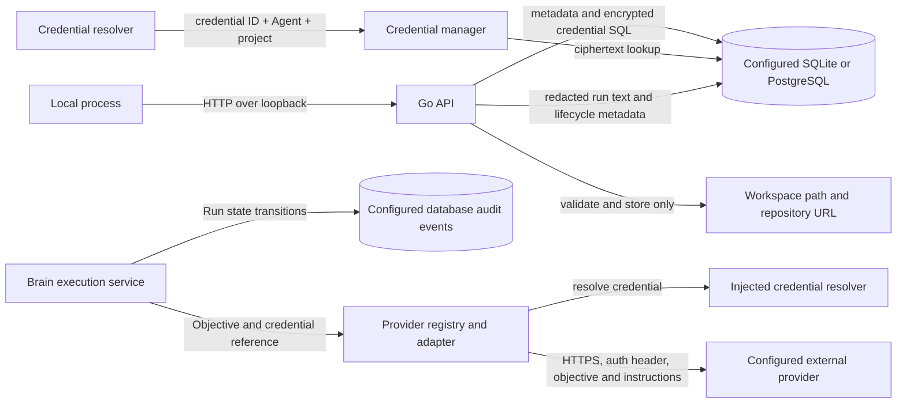

# boAIrd Threat Model

> This model distinguishes controls present in source from documented future goals. Threat rows describe plausible risks; they are not claims of confirmed vulnerabilities.

## 1. Current implementation and scope

boAIrd currently starts a local Go HTTP service with SQLite by default or explicitly configured PostgreSQL storage. SQLite remains the local-first default; PostgreSQL may be remote and therefore adds a database transport, credential, operator, and backup trust boundary. The service exposes health/status endpoints, project create/list/read/update/archive operations, metadata-only credential management, agent configuration create/list/read/update operations, Brain execution and run history, Kanban task create/list/read/assign/transition operations, and orchestrator dispatch/review operations that execute assigned API Agents and apply the Brain verdict with bounded retries and escalation. The configured host must be a loopback IP address by default (`127.0.0.1:3110`); a non-loopback bind is accepted only with authenticated remote mode plus TLS. Project rows may contain a name, description, Brain reference, workspace path, repository URL, lifecycle state, and human-review flag.

The authenticated API also exposes built-in specialized profile definitions and project-scoped profile overrides. The profile catalog describes responsibilities and suggested defaults; it does not define task authorization scope or grant authority.

Provider-neutral request/model types, a registry, and adapters for OpenAI, Anthropic, DeepSeek, Gemini, and OpenAI-compatible APIs are implemented under `internal/provider`. Adapters resolve credentials through an injected `CredentialResolver`, use HTTPS by default (HTTP only for explicit loopback), disable redirects and proxies, validate DNS answers at dial time, pin the validated address for the connection, bound request/response sizes and request duration, and omit provider error bodies from returned HTTP errors. Built-in vendor hosts are allowed; custom hosts require an exact `BOAIRD_PROVIDER_ALLOWED_HOSTS` entry. Private, link-local, metadata, and other special-use destination IP ranges are blocked unless explicitly included in `BOAIRD_PROVIDER_ALLOWED_IP_RANGES`. The application configures the provider registry for Brain execution on demand. Credential ciphertext is stored in the configured database using AES-256-GCM with a deployment-supplied `BOAIRD_MASTER_KEY`; the key is not stored in the database. The configured `BOAIRD_LOCAL_AUTH_TOKEN` authenticates the bootstrap `local-administrator` in constant time. Administrators can issue 30-minute HttpOnly, SameSite=Strict opaque sessions to registered users; each request resolves the current user's role, and deleted users or revoked sessions are denied. Logout, user deletion, membership revocation, and service restart invalidate in-memory sessions. Unsafe cookie requests require a trusted dashboard Origin. Direct Bearer authentication remains available to local API clients. User, membership, and session issuance changes are recorded in an immutable authority audit table and exposed only to administrators. Structured logs redact sensitive attribute names and common bearer/provider token patterns.

Agent configuration validates runtime, provider/model/credential references, languages, instructions, and explicit capabilities. The `role` field is descriptive and does not grant capabilities. Agent project scope is persisted in `agent_projects`, loaded with Agent records, and managed by authenticated administrator routes; actual scope changes are recorded in immutable audit history. Human users are separate from Agents and have global administrator or member roles plus project membership. REST operations map to explicit capabilities in a Go authorizer. Project listing is global for administrators and filtered by membership for members; Agent listing is global for administrators and filtered for members. Member Agent detail and status-event reads require direct or active-Brain association with a current member project and omit foreign project IDs from responses. Members have read-only capabilities and cannot manage users, credentials, or scope. The authenticated MCP Agent must have the required capability and explicit persisted project membership for project-wide operations. An exact task assignment permits only task-specific operations after the task is loaded and its assignee is checked; it never adds project scope. An active Brain gets scope only from its Brain-to-project relation. Cross-project MCP denials are recorded in the immutable authorization denial table. Projects can attach one active Brain to an API or authenticated MCP agent with the explicit `brain.execute` capability. API Brain objectives invoke the configured provider and persist a Run; an MCP Brain uses its authenticated, capability-checked tools, while the provider-run endpoint rejects MCP Brains without creating a run. Provider output remains proposed text and does not itself mutate tasks or project policy. Brain task actions pass a separate autonomy gate: `MANUAL` is plan-only, `SEMI_AUTO` permits capable task creation, assignment, transitions, and review but requires human approval for completion, and `AUTONOMOUS` may complete only when `task.complete` is granted and project human review is disabled. Autonomy never adds capabilities. Only the administrator can change the Brain mode, and the mode change is recorded in immutable audit. The task service persists tasks, checks workflow transitions and explicit agent/Brain/administrator capabilities, applies project human-review policy, and records immutable audit events for mutations. It rejects the legacy unprivileged local actor. Conversations are stored per task; agent messages require assignment to that task and Brain messages require the project's active Brain. Human conversation reads/writes resolve the registered user and require a `project_members` row; new projects and existing projects are assigned to the bootstrap administrator. User, membership, and session issuance changes are transactional with immutable authority audit records. Message history is bounded and cursor-paginated. Message content and metadata are redacted before persistence. Caller-supplied sender identity is rejected. Project workspace paths and repository URLs are validated and persisted; the project API does not read workspace files, clone repositories, or fetch repository URLs. Loopback binding limits network exposure but does not isolate local processes that possess the administrator token.

MCP Agent tokens are issued, rotated, revoked, and listed through authenticated administrator routes. Tokens are random 32-byte values with explicit expiry capped at 365 days; only their SHA-256 verifiers and metadata are stored. Plaintext is returned once. Legacy environment tokens are imported once with a 90-day expiry. Token lifecycle events are immutable and do not contain secret material. Verification runs on every MCP HTTP request, so revocation blocks subsequent requests on existing sessions; a request or stream already in progress may finish. Access to the configured database or process memory remains within the trusted host/database-operator boundary.

| Surface | Implemented behavior | Security boundary and limitation |
| --- | --- | --- |
| CLI and configuration | `boaird serve`; reads host/port/database settings and requires `BOAIRD_MASTER_KEY` and `BOAIRD_LOCAL_AUTH_TOKEN` as 64 hexadecimal characters. Host must parse as an IP; non-loopback requires `BOAIRD_REMOTE_MODE` with TLS certificate and key. | Authenticated remote mode requires TLS, rate limiting, security headers, and explicit trusted proxies. Every versioned route except status requires the token or browser cookie; route capabilities and project membership are checked in Go. |
| Remote request boundary | Remote mode rate-limits versioned API requests except `/api/v1/status`, and also limits `/mcp`, using the resolved client IP. `X-Forwarded-For` is accepted only from a configured trusted direct peer and traversed right-to-left, skipping trusted proxy hops. | Misconfigured trusted proxy ranges can still let a peer influence client attribution; malformed forwarded entries fall back to the direct peer. The limiter is in-process and its buckets are not shared across multiple server instances. |
| HTTP API | Health/status, project CRUD/archive, user and membership management, administrator-issued user sessions, credential create/list/delete, project-scoped agent reads/configuration, Brain attach/read/replace/execution/run history, task workflow, task conversations, project and user-authority audit listing, and authenticated remote session routes. Project audit requires `audit.read` and membership; global user-authority audit requires `user.manage`. Pagination is bounded (default 50, maximum 100, non-negative offset). User, membership, and session issuance mutations commit atomically with their immutable authority audit event. Credential responses contain only ID, name, and provider; request JSON is size-limited and rejects unknown fields. Task mutation requests require a reason and actor identity is fixed by the server. Conversation routes resolve the current user and check project membership; Brain replacement is administrator-only and records an audit reason. Project-specific routes require current membership even for administrator-role users; that role grants capabilities but does not imply project scope. The bootstrap administrator is seeded into every project, while other administrators must be granted membership. Administrator project and Agent list endpoints remain global; member listings are filtered before pagination. | The bootstrap administrator token grants administrator capabilities. Other users receive only read-only capabilities and current project scope; local OS users remain outside the application authorization boundary if they can inspect process/browser state. |
| Agent configuration and scope | Agent create/list/read/update and administrator-managed project memberships; role is descriptive, runtime status is read-only, explicit capabilities are stored, and project IDs load from `agent_projects`. Membership and credential-binding changes are audited. Provider credential resolution requires the Agent credential binding plus project membership or the active Brain relationship. | Only the authenticated local administrator can configure Agents and scope. Role labels do not grant authority. Project-wide MCP actions require persisted scope; task assignment grants access only to that exact task. |
| Agent runtime execution | The shared `runtime.Enforcer` invokes an injected scope authorizer before resolving adapter capabilities or calling `Execute`. Application policy requires persisted project membership for project-scoped requests; when `TaskID` is supplied it additionally validates that exact `WORKING` task's project and assignee. Exact task assignment may provide task-only scope; declared capabilities and normalized execution errors are enforced after scope. | Runtime selection does not grant scope. API credential resolution is an additional provider boundary, not the runtime scope control. MCP/LOCAL/REMOTE adapters cannot be trusted to enforce project/resource scope themselves; the Enforcer must remain the common pre-adapter gate. Active Brain execution uses its separate Brain/project authorization path. |
| Brain and runs | Project Brain attach/read/replace and objective execution; replacement requires the local administrator bearer token and audit reason; only API or authenticated MCP agents with `brain.execute` may be attached; provider output and run state are persisted; autonomy does not grant capability. | API Brain runs return proposed text only and do not apply mutations. MCP Brain actions use authenticated tools with explicit capabilities, project scope, and domain policy; the local provider-run endpoint rejects this runtime. Brain attachment and replacement require the authenticated administrator; provider-bound objectives/responses may contain sensitive data. |
| Run history and audit | Run input/output/tool/error text is redacted for common secret patterns before persistence and display. Both storage adapters create immutable audit rows for Run creation/status changes and Brain replacement; project history filters Runs by task and agent. | Redaction is pattern-based and cannot identify every secret format. Run content is stored as plaintext after redaction. SQL triggers protect audit rows from application updates/deletes but do not protect against a privileged database operator or local OS user who can alter the database/schema. |
| Task workflow and audit | Backend validates task state transitions, rejects worker task creation by default, checks explicit capabilities for Brain/agent actions, applies human-review policy, and stores actor/reason on mutations. Both storage adapters record immutable creation, assignment, and status events. | The API derives the administrator actor only after authentication; the task service independently checks explicit capability and project scope. Authorization denials are stored immutably. Audit triggers do not protect against a privileged database operator or local OS user who can alter the database or schema directly. |
| Task conversations | Every task has one persisted conversation. Messages store opaque content, content type, JSON metadata, sender identity, and timestamp. The HTTP API resolves the authenticated human user and requires current project membership for reads/writes; agent/Brain sender identities are checked against task assignment or the active project Brain. History is cursor-paginated and content is redacted. | The configured bearer identifies the bootstrap administrator; browser sessions are administrator-issued and bound to registered users. Other versioned API routes use the same current-user resolution, capability, and membership checks. Redaction is pattern-based and cannot identify every secret. Conversation rows are not protected by immutable audit events. |
| SQLite | Opens/migrates the configured local database; creates parent directories with mode `0700` and database file mode `0600`. Credential secrets are stored only as AES-256-GCM ciphertext; agent rows store provider configuration and credential IDs. | Permissions on a pre-existing parent directory are not changed. Local OS users with database access can read or replace ciphertext and metadata. |
| PostgreSQL | Optional storage selected explicitly with `BOAIRD_DATABASE_DRIVER=postgres`; the pgx-effective host and every fallback are checked before connection. Every remote target requires TLS with CA-chain and hostname verification (`sslmode=verify-full` semantics). PostgreSQL migrations are applied one at a time in transactions while holding an advisory lock. | `BOAIRD_DATABASE_URL` can contain credentials and must be protected as a deployment secret. The database operator can read, alter, or delete all stored application data and audit history. The current service uses one credential for application operations and startup migrations, so that role needs the required schema privileges; separate runtime/migration roles are not supported yet. PostgreSQL-native backups/restores are outside the application and require encryption, access control, and verification. TLS protects transport, not database-server or backup data at rest. |
| Project data | Validates project names, workspace paths, repository URL schemes, page limits, and Brain references; SQL uses parameters. | Workspace and repository values are stored, not acted upon by this API. Project access requires current membership; member project listings are filtered before pagination. |
| Provider adapters | Provider-specific chat/model requests; credential reference resolved immediately before each HTTP call; bounded JSON transport and sanitized HTTP status errors. The Brain runtime invokes chat on demand. | Prompt objectives and Brain instructions are sent to the configured provider. No context-selection/consent policy or provider endpoint allowlist is implemented here. |
| MCP, tools, dashboard, general audit | The standalone Angular dashboard, authenticated MCP adapter, REST authorization, and project-scoped audit listing are implemented. Human users have global administrator/member roles and explicit project memberships; members receive read-only capabilities and project-scoped project/Agent listings. MCP uses expiring Agent-token verifiers, administrator-only issue/rotate/revoke operations, and immutable lifecycle audit; explicit capabilities, persisted Agent project membership, or active-Brain project scope apply to tool calls. The optional shell tool is gated by `BOAIRD_SHELL_ENABLED`, an administrator executable allowlist, `shell.execute`, project scope, workspace path checks, timeout, output cap/redaction, and metadata-only immutable audit. Revocation is checked on every HTTP request. | The bootstrap administrator remains one local principal; user sessions, authority audit data, and Agent-token verifiers are stored in the configured database or process memory and do not protect against an OS user or database operator who can alter the database, schema, or process memory directly. A request or stream already in progress may finish after token revocation. Workspace/path checks are not an OS sandbox: an approved executable may read other local files or launch absolute-path subprocesses as the boAIrd OS user. |

### Effective configuration and data locations

| Resource | Configuration | Current default or enforcement | Security notes |
| --- | --- | --- | --- |
| HTTP listener | `BOAIRD_HOST`, `BOAIRD_PORT` | `127.0.0.1:3110` by default; non-loopback IPs require remote mode with TLS (minimum TLS 1.2). | Local mode is plain HTTP on loopback. Remote mode terminates TLS at the listener and applies security headers plus per-client-IP rate limiting. All versioned routes except status authenticate a registered user; the configured bearer token identifies the bootstrap administrator, and member sessions are administrator-issued. Same-host processes that can read the configured token or use an active browser session remain trusted. |
| Local administrator identity | `BOAIRD_LOCAL_AUTH_TOKEN` | Required 32-byte bearer token encoded as 64 hexadecimal characters; maps to `local-administrator`. | Keep separate from `BOAIRD_MASTER_KEY`. The dashboard exchanges the token for a session-only HttpOnly cookie. Token rotation requires updating the environment and restarting the process. |
| SQLite database | `BOAIRD_DATABASE_PATH` | `./data/boaird.db`; newly created parent/file modes are `0700`/`0600`. | A caller may choose another path; existing parent-directory permissions and symlink ownership are not hardened by the current code. |
| PostgreSQL database | `BOAIRD_DATABASE_URL` | Empty unless `BOAIRD_DATABASE_DRIVER=postgres`; every effective remote host/fallback must use verified TLS with hostname validation. | Protect the URL as a secret. Restrict database network ingress and grant the single configured role only privileges needed by application operations and startup migrations. Separate runtime/migration credentials are not supported yet. Encrypt and access-control native backups. The database operator remains trusted with all data and audit records. |
| Provider endpoint | `provider.Config.BaseURL` and `EndpointPolicy` | Vendor defaults and explicit loopback endpoints are allowed; custom hosts require an exact configured allowlist entry; resolved private/special-use ranges require a CIDR allowlist entry. DNS answers are checked and pinned at dial time; redirects and proxies are disabled. | The local administrator can approve an arbitrary host or IP range. An approved endpoint can receive provider credentials and prompts; DNS and public routing remain external dependencies. |
| Provider credential | `BOAIRD_MASTER_KEY`, credential ID, Agent ID, and project ID | Secret is encrypted at rest and returned by the credential API only as metadata. Resolution requires the credential to be attached to the requesting Agent and the Agent to have persisted membership in the requested project or be that project's active Brain; provider names must match. Missing or mismatched scope fails closed. Credential management and metadata are administrator-only. | Master key is held in process memory and supplied by deployment; key rotation is not implemented. |
| Workspace/repository metadata | Project API request fields | Workspace path must resolve to an existing directory; repository URL must use HTTP, HTTPS, or SSH. | Values are only stored today. Any later clone/read/write behavior needs a separate SSRF/path/authorization review. |

### Data flow

API Brain objectives use provider adapters, with Run records and lifecycle audit events persisted by the configured database. An external MCP Brain connects with its Agent token and uses the running MCP tool server; the active Brain relationship derives its project scope, and the server attributes task mutations as Brain actions so the task service applies capability, autonomy, workflow, and Human Review policy. Delegation uses the observed task version, so stale retries fail without reassigning work. Local and remote non-MCP runtimes are not connected to the service.

Project notifications are created transactionally from audit/status records by triggers in both storage adapters. Fixed summaries omit raw request paths, denial reasons, provider errors, credentials, and task/run payloads. The local administrator accesses the persisted project inbox through project-scoped REST authorization; SSE is best-effort only. Delivery has three automatic attempts and at most two manual retries, after which a failure remains visible until acknowledged.

## 2. Assets, actors, and assumptions

### Assets

- Project names, descriptions, lifecycle state, Brain association, and configuration metadata stored in the configured database.
- Local database integrity and availability.
- Workspace path and repository URL metadata, which may reveal local layout or private repository locations.
- Provider credentials resolved for Brain calls, provider-bound objectives/instructions, provider responses, persisted Run text, and Run lifecycle audit events.
- Assets not currently handled by the application: general agent execution authority beyond the implemented MCP tools, arbitrary tool authority, kernel-level isolation for optional shell and Git execution, complete audit coverage for every successful mutation, and tenant isolation between separate organizations. Agent roles remain descriptive; Brain execution requires the explicit capability and active project relationship.

### Actors and capabilities

| Actor | Current capability | Not assumed |
| --- | --- | --- |
| Local user launching boAIrd | Selects environment configuration and database path; can stop or restart the process. | No remote administrator role is implemented. |
| Other process on the same host | Can attempt HTTP requests to the loopback listener. The API authenticates versioned requests with the bootstrap administrator token or a user-bound cookie and applies current role, capability, and project membership. | It does not automatically have direct database access: SQLite relies on OS file permissions and PostgreSQL relies on network controls and database credentials. |
| Agent configuration caller | Must authenticate as the local administrator to create or update agent configuration, including explicit capability labels. | A role label does not grant authority. Brain execution requires `brain.execute` and returns proposed text without tools or project mutations. |
| Remote network caller | Cannot reach the default loopback listener remotely. A remote deployment requires `BOAIRD_REMOTE_MODE`, TLS, authentication, security headers, and per-client-IP rate limiting. | No claim is made about host firewall, port forwarding, local proxies, or a separately exposed reverse proxy. Trusted-proxy configuration is the only way forwarded headers influence client identity. |
| Provider configuration owner | Chooses provider configuration and Brain instructions through the local API. | The adapter does not select or filter project context or validate that a credential is authorized for a particular project. |
| Configured provider | Receives Brain objectives/instructions and its credential in the required auth header when a Brain run is requested. | The service does not automatically call providers at startup. |
| Authenticated MCP Agent or client | May attempt to read or mutate another project's data, expand scope through assignment, or reuse a session under another identity. | Each session is bound to its authenticated Agent; project-wide operations require persisted membership, task-level exceptions check exact assignment, and denials are recorded. A defect in any MCP handler could still bypass the intended scope, so all routes must use the shared authorizer/domain services. |

### Trust boundaries

1. **Local process to HTTP API.** The listener is loopback-only. All versioned routes except status require the local token or session cookie. Project-scoped operations check membership and operation capabilities in Go; cookie-authenticated writes enforce SameSite and a dashboard-Origin allowlist.
2. **HTTP API to domain managers and configured storage.** Request decoding is bounded and rejects unknown JSON fields; domain validation and parameterized SQL protect input handling. Brain execution requires explicit `brain.execute`, and autonomy mode does not add permissions. The API resolves current user roles, checks project membership, filters project and Agent lists before pagination, and denies missing or deleted identities. User and membership changes are audited transactionally.
3. **Provider adapter to credential resolver.** The adapter passes the credential reference and server-derived Agent/project context to the injected resolver. The credential manager checks the Agent's credential binding, provider match, and current project membership or active-Brain relation before decrypting. The returned value is sent only in the provider auth header. Scope updates are administrator-only and project/Brain/Agent credential changes are recorded in audit history; key rotation is not implemented.
4. **Provider adapter to external host.** HTTPS is required except for loopback development endpoints. Redirects are not followed, and error response bodies are not returned. Custom HTTPS base URLs remain caller-trusted, so a party controlling provider configuration can select the recipient host.
5. **Project metadata to filesystem or Git.** The current API validates and persists these strings but performs no filesystem operation, clone, DNS lookup, or network fetch based on the repository URL.
6. **Credential, agent, and provider boundary.** Brain runs resolve a stored credential using its ID plus the active Brain Agent and project; unscoped, cross-project, deleted-scope, and provider-mismatched requests are denied before decryption. Provider error bodies are not stored, and common credential forms are redacted from run text. Pattern-based redaction is incomplete and Run content remains readable from the local database. Provider endpoint selection, key rotation, Brain run quotas, and audit for unrelated resource mutations remain future boundaries.

## 3. Threat scenarios and mitigations

These are hypotheses to guide implementation and review. Priority reflects potential impact if prerequisites are met.

| Priority | Scenario and impact | Prerequisites | Current controls and limits | Mitigation / follow-up |
| --- | --- | --- | --- | --- |
| P2 | **Notification content disclosure or silent loss:** project data is exposed through notices or a critical event is not delivered. | An authenticated administrator can access one project, or a database trigger/application path creates an event. | Triggers derive notices from persisted event IDs and use fixed summaries; denial resources and raw reasons are excluded. Source keys are unique. REST checks administrator authentication, notification capability, and project membership. SSE delivery is best-effort with three automatic attempts and up to two manual retries; rows remain visible as pending/failed until acknowledged. | Keep summaries metadata-only, preserve source-key uniqueness, and test project scope, redaction, retry limits, and durable inbox behavior. |
| P1 | **Same-host administrator credential exposure:** another local process reads or changes projects through the loopback API after obtaining the administrator token/session. | Attacker can inspect the token environment, browser profile, or a trusted local process. | Non-loopback bind is rejected; the versioned API requires the local token or an opaque 30-minute server-side session, explicit route capabilities, and project membership. Logout revokes the session and restart clears all sessions. Users and membership are modeled separately from Agent/Brain identity; OS-user isolation remains out of scope. | Protect the root token and browser session from other local users; add OS-user identity isolation before supporting shared hosts. |
| P1 | **Cross-user or cross-project data access:** a user reads or mutates tasks, conversations, credentials, Runs, audit, Agents, or membership outside their granted projects, or escalates to administrator authority. | A member obtains a session, a membership is stale or missing, an unscoped list/detail route is added, or the authorization layer trusts a hardcoded administrator identity. | Every request resolves the current authenticated user and role; project-scoped routes check `project_members` before capability evaluation. Administrator project and Agent listings are global; member listings filter in storage before pagination. Member Agent details and status events require direct or active-Brain association with a current member project, while administrator-role users may read Agent details globally. Members receive a read-only capability set and cannot manage users or membership; missing/deleted users are denied, and the bootstrap administrator cannot be deleted or demoted. User and membership mutations are committed atomically with immutable audit records; deletion and membership revocation invalidate the user's in-memory sessions, and deleted user IDs are tombstoned so stale memberships cannot transfer to a recreated identity. | Retain regression tests for allowed membership, cross-user, cross-project, revoked, pagination, and privilege-escalation denial. Review every new global list/detail route for a project-scope requirement. |
| P1 | **Git mutation bypasses project approval or inherits host execution credentials:** a caller pushes/merges without a valid same-project human approval, or repository configuration/environment invokes hooks, helpers, SSH, filters, or an external merge driver. | An MCP Agent has a Git capability and project scope, and Git tools are enabled; a project policy lookup fails or caller-supplied task/run IDs are cross-project. | Push/merge fail closed on Human Review policy errors; approved tasks must be `DONE`, Human Review-enabled, and belong to the requested project. Supplied Runs must belong to that project and match the supplied task. Scope failures omit task/run references from tool audit. Git receives a minimal environment with system/global config disabled; hooks, credential helpers, GPG signing, proxy, inherited headers, and SSH are disabled; only HTTPS is enabled, credential-bearing URLs and URL-specific transport credentials are rejected, and push targets one checked-out branch only after enumerating and validating exactly one configured push URL. Zero or multiple URLs are rejected. External diff/textconv and configured merge drivers/filters are rejected. | Keep these controls in the shared Git runner and project scope authorizer; add dedicated credential integration before permitting authenticated remote operations, and prefer OS sandbox isolation before widening Git behavior. |
| P1 | **GitHub tool crosses repository, credential, review, or capability boundaries:** a GitHub token for another provider is disclosed, a redirect leaves the approved repository API, a lookalike SSH host is accepted, issue capabilities operate on PRs, or a stale PR head is merged after review. | An MCP Agent has a GitHub capability and project scope, and GitHub tools are enabled; an administrator creates or revokes an integration binding, or the PR changes between review and merge. | A local administrator binds a `github` credential to one MCP Agent and project; the grant/revocation and immutable audit event commit atomically. MCP inputs cannot select a credential ID. Resolution requires RuntimeMCP, current project scope, a non-archived project, and a `github` provider before decryption. Repository URLs reject user-info, ports, queries, fragments, encoded separators, invalid path segments, and non-exact SSH hosts; HTTP redirects are not followed. Issue read/update reject PR-marked resources and list filters them. Merge fails closed on Human Review lookup errors and sends the expected full head SHA for GitHub's concurrency check. | Keep binding and provider/resource checks in shared boundaries; require a fresh PR head SHA after changes and preserve negative tests for each boundary. |
| P1 | **Profile override grants unintended authority or lacks audit evidence:** a project profile's capabilities/tools are interpreted as broader scope, or a failed audit write leaves an untracked override. | An authenticated administrator configures a profile, or a future consumer trusts profile metadata as authorization. | Profile names and descriptions grant no authority or task scope. Only explicit administrator overrides grant configured capabilities/tools for the matching project; tools are limited to the profile's suggested set and still require backend authorization. Override and immutable `profile.created`/`profile.updated` audit inserts commit in one transaction in the configured database, so either both persist or neither does. | Keep profile metadata separate from task/project authorization; retain transaction rollback coverage and inspect consumers before adding profile-driven execution. |
| P1 | **Template instantiation grants unintended authority or leaves partial state:** a template's suggestions are treated as grants, an Agent is created without project scope/provenance/audit, or archival races with instantiation. | An authenticated administrator instantiates a project Agent from a template while another request archives that project. | Template metadata and suggested capabilities/tools never grant authority; the instantiated Agent receives only explicitly requested capabilities. The transaction first locks and rechecks the project row as not `ARCHIVED`, then writes the Agent, capabilities, project membership, provenance, and successful audit events atomically. An archive operation therefore commits before the check and is rejected, or waits until instantiation commits. Instantiation requires `agent.create` and `agent.scope.manage` plus project membership; API-runtime templates require explicit `provider`, `model`, and `credential_id`. Template updates use version compare-and-swap and reject stale writers. | Keep template metadata separate from authorization; retain archived-project transaction and rollback regressions plus CAS coverage. |
| P1 | **Provider credential disclosure or misuse:** a credential reaches an unintended host, log, or caller, or is used outside its intended project. | An attacker obtains the local administrator token/session, the master key is exposed, or a provider adapter is invoked with compromised configuration. | AES-256-GCM with per-record random nonce and ID/provider authenticated data; ciphertext-only persistence; metadata-only API responses; structured log redaction; provider transport applies the endpoint policy and blocks redirects. Resolution checks the Agent's credential binding, project membership or active-Brain relation, and provider match before decryption. Scope changes require the authenticated administrator path and are recorded in audit history. Key rotation is not implemented. | Protect the administrator token and browser session; define key rotation; keep credentials out of URLs and agent-visible data. |
| P1 | **Cross-project Agent runtime execution:** an adapter executes a request against a project or task outside the Agent's authorization scope. | A caller can submit a runtime request with a mismatched project/task, or a future adapter omits its own scope check. | The shared Enforcer runs the app's scope authorizer before invoking any adapter. Project-scoped requests require persisted membership; a supplied task ID must resolve to the exact `WORKING` task with matching project and Agent and may provide task-only scope. Adapter capabilities are checked separately. API credential scope is defense in depth only. The active Brain path is separately authorized and does not inherit a runtime exemption. | Preserve the common pre-adapter project/resource check for every runtime kind and retain regression tests proving an out-of-scope request never invokes even a credential-free fake adapter. |
| P1 | **Tool executes without authority or crosses project scope:** a registered tool performs an action the caller was not granted or targets a resource outside its project. | A caller reaches a tool execution path, or a future tool bypasses shared enforcement. | The generic tool Enforcer requires declared capabilities and an application-supplied authorizer that resolves the resource to its project before strict input validation or adapter invocation; it cannot be constructed without this authorizer. Calls are bounded by declared time and size limits. The controlled MCP shell tool is a concrete tool wired through this Enforcer: it requires the explicit `shell.execute` capability and project scope (persisted membership or the active-Brain relation), an administrator-configured non-empty executable allowlist, workspace/symlink resolution, bounded output, timeout with Unix process-group kill, and metadata-only audit. A `start` audit event is persisted before the process is launched; if that write fails, no process starts. The governed Git tool set is also wired through this Enforcer: six operations with separate capabilities, repository resolution verified inside the workspace (symlink-safe), push/merge denied by default plus a Human Review gate, structured `git -C` arguments only, bounded/redacted output, timeout, and metadata-only audit with a `start` event before any mutating command. Local OS/database owners remain outside this boundary. | Require every tool invocation to pass through the Enforcer, and keep tool-specific path/command/repository validation and regression tests as new concrete tools are added. |
| P1 | **Untrusted extension gains filesystem, secret, or program execution access:** an installed extension reads files or secrets or executes arbitrary programs beyond its reviewed, capability-checked tool contract. | An administrator installs or activates a manifest, or a future extension runtime adds an executable kind. | Extensions are declarative manifests (`sdk_version: 1`), never executable code. Manifest validation rejects any tool whose `data_access` is not `none` or `network:<host>`, and HTTP endpoints must use an exact administrator-allowlisted public DNS host on HTTPS port 443; the declaration's network host must match it. The shared provider endpoint policy revalidates DNS at connect time, rejects private/special-purpose answers, pins the selected address, disables proxies and redirects, and requires TLS 1.2 or later. `http` tools send one bounded `POST`; input and redacted output are checked against the bounded schema subset. `declarative` tools are contract-only and unregistered as executable. Activation registers tools atomically before persisting active state; active-state, capability, and project/task/run scope enforcement runs before each adapter call. Deactivation removes persisted active state and audit atomically, immediately denying further calls before in-memory unregister. Lifecycle data and immutable events have SQLite and PostgreSQL migrations. | Keep manifest validation deny-by-default for data access and executable kinds; review administrator endpoint allowlists and maintain DNS/redirect/schema/scope/lifecycle regression tests; add any future executable kind only through a core-reviewed, capability-checked adapter. |
| P1 | **Sensitive prompt/context disclosure to a provider:** project or workspace content is sent externally without approval. | An authenticated administrator submits an objective or configures agent instructions and triggers a Brain or worker run. | Brain sends the objective and configured instructions to the selected provider. Worker context is selected with project/task scope, trust provenance, secret-pattern redaction, and byte/token budgets. Conversation access is assignment-scoped; Run history is same-task/same-Agent. Approved task summaries use sanitized task, successful Run, and authorized conversation excerpts and are persisted with source provenance; when Human Review is required, persistence waits until the administrator transitions `HUMAN_REVIEW` to `DONE`. Rejected/cancelled work is not retained as task memory. Selected memory is later sent as untrusted, bounded context to workers. Workspace files, Git, issues, and PRs are not read. Pattern redaction may miss sensitive data. Explicit consent/data-use policy and provider destination disclosure are not implemented. | Add explicit provider/data-use policy and surface the destination and data classes before remote or multi-user use; keep context minimization and scope regression tests. |
| P1 | **Provider endpoint misuse / SSRF:** a malicious or mistaken config points a provider adapter at an unintended endpoint or private service. | A component accepts a custom `BaseURL` and calls an adapter. | Built-in provider hosts and explicit loopback URLs are allowed. Custom hosts must be named in `BOAIRD_PROVIDER_ALLOWED_HOSTS`; every dial resolves and validates all returned IPs, rejects private/link-local/metadata and special-purpose ranges recognized by the endpoint policy unless a configured CIDR allows them, and connects to the validated IP directly. The IPv6 policy covers active IANA special-purpose prefixes and translation/transition ranges, including NAT64, Teredo, and 6to4. Redirects and proxies are disabled. | The bootstrap administrator controls endpoint and CIDR allowlists. A deliberately approved host/range can still reach internal services, and approved public hosts receive credentials and prompts. DNS resolution and public routing are external dependencies; re-evaluate the IANA registry when updating the policy and if untrusted users can configure endpoints or remote mode is added. |
| P2 | **Project metadata becomes an unsafe file or network operation:** a feature reads a stored workspace path or fetches a repository URL without sufficient containment. | The shell tool, the Git tool, or a later agent/runtime feature consumes project metadata. | Workspace paths are canonicalized to existing directories and repository URLs are scheme-checked at storage time. The shell tool uses the canonical project workspace as cwd and validates cwd/path-like arguments against workspace and symlink boundaries in user space. The Git tool resolves the canonical repository root and verifies it is contained in the canonical workspace before each operation. Git commands use a minimal environment, disable hooks/helpers/SSH, reject external merge drivers and filters, and permit only HTTPS remote transport. This remains user-space validation, not a kernel filesystem sandbox; Git itself and explicitly approved HTTPS remotes still access resources as the boAIrd OS user. | Revalidate paths at use time, restrict outbound destinations before permitting remote operations, and prefer OS sandbox isolation before widening tool behavior. |
| P2 | **SQLite disclosure or tampering:** another local account reads or replaces project data. | Attacker can access the database path or parent directory under OS permissions. | Newly created database directories/files use restrictive modes. Existing parent permissions, symlink ownership, backups, and filesystem-level access are not managed here. | Document secure placement and backup permissions; harden symlink and existing-directory handling if the local threat model includes other OS users. |
| P1 | **Remote PostgreSQL disclosure, tampering, or migration privilege abuse:** database traffic or backups are exposed, a server identity is spoofed, or a database principal changes application data/schema. | An attacker can observe or redirect the database network path, obtain the connection URL, access PostgreSQL credentials, operate the database service, or access its backups. | The pgx-effective configured host and all fallback hosts are inspected; each remote target must use CA and hostname-verified TLS. The URL is deployment configuration, migrations use an advisory lock and one transaction per migration, and the application stores credential ciphertext protected by `BOAIRD_MASTER_KEY`. TLS does not protect data at rest. The same configured role performs application operations and migrations and therefore has schema privileges; separate credentials are not supported yet. The database operator can modify or erase all application rows, including audit history. | Grant the configured role only privileges required by application operations and startup migrations; restrict network ingress; protect URL secrets and native backups; verify backup restoration and migration procedures. Treat the PostgreSQL operator and backup administrators as trusted data principals. |
| P1 | **Authenticated local caller consumes provider quota:** a local administrator repeatedly submits objectives that incur provider costs. | Attacker obtains the local administrator token/session and a configured credential is usable. | Brain execution bounds request size and max_tokens (1–4096), persists a Run, and is covered by the configured per-client-IP HTTP request limiter. The limiter is process-local and is not a per-project/provider cost quota; callers behind one NAT share a bucket. | Keep rate-limit configuration bounded and add per-project/provider usage budgets before shared-host deployment. |
| P1 | **MCP project scope expansion:** an Agent uses task assignment or an active Brain association to obtain project-wide access outside its grant. | MCP tool requests reach project or task handlers. | Explicit persisted Agent membership gates project-wide actions; assignment is limited to the exact task; active Brain scope is derived from its current project relation; denials are audited. | Keep per-tool authorization tests and ensure new MCP operations use the shared capability and resource-scope checks. |
| P1 | **Orchestrator-executed work misattributed or unbounded:** the orchestrator triggers worker provider calls, retries, or review mutations outside policy, or leaves a task unrecoverable after client cancellation. | A project has an active Brain, a READY task assigned to an API Agent, and an authenticated caller reaches dispatch/review. | Dispatch and review require `brain.execute` through `Brain.AuthorizeAction` before any provider call; every transition runs through `task.Service` (capability, autonomy, Human Review, optimistic concurrency), so a concurrent claim cannot execute twice. Worker attempts are persisted as worker-kind Runs, so Brain failure-analysis Runs do not consume `BOAIRD_ORCHESTRATOR_MAX_ATTEMPTS` and reassignment cannot reset the budget. A short bounded cleanup context survives request cancellation and finalizes run, task, and escalation, preventing stranded `WORKING` tasks. Escalation is an immutable, redacted audit event. | Keep integration coverage for duplicate claims, `brain.execute` denial, attempt accounting, and cancellation recovery; add per-provider usage budgets and dispatch rate limits. |
| P2 | **Agent liveness or status spoofing:** a caller claims another Agent's liveness, or fabricates a status to mislead the board or a reviewer. | A caller holds any valid MCP token, or reads status through the versioned API. | Status is never accepted from clients: it is derived from the verified token identity plus observed work. Sessions are keyed by `(agent_id, token_id)`, a heartbeat naming another Agent is denied and recorded as an authorization denial, silent sessions expire on a configured schedule, and status events are immutable at the database layer. Revoked or expired tokens cannot refresh a session. | Keep derivation server-side in future runtimes, bind new execution paths to the same credential identity, and re-review if status starts gating authorization instead of describing it. |
| P2 | **Audit disclosure, incomplete event classification, or local tampering:** a caller reads another project's audit events, an event lacks its outcome, pagination is abused, a sensitive mutation is not attributed, or a local database owner edits history. | A caller reaches project audit routes, a sensitive resource mutation occurs, or an attacker can write to the SQLite file. | The audit route requires `audit.read` and project membership; event writes require a non-empty result; limit defaults to 50 and is bounded to 1–100 with non-negative offset. Run create/status and profile override/audit pairs are transactional; SQLite triggers reject updates/deletes through the application, while an OS-level database writer can alter rows or triggers directly. Audit coverage remains incomplete for some resource mutations. | Keep authorization and pagination regression tests, extend audit coverage to sensitive mutations, and use protected backups or external append-only storage if local database owners are in scope. |

## 4. Verification evidence and scope limits

The source inventory for this model includes the executable and configuration under `cmd/boaird` and `internal/config`, HTTP routing under `internal/api`, project, agent, Brain, run, profile, template, and credential services, SQLite and PostgreSQL access under `internal/storage`, structured log redaction under `internal/logging`, provider contracts/adapters under `internal/provider`, provider-independent Agent runtime enforcement under `internal/runtime`, and the generic typed tool contract, explicit registry, capability/resource enforcer, and metadata-only audit writer under `internal/tool` and `internal/storage`. The runtime composition in `internal/app` wires project, agent, credential, Brain, profile, template, run, task, conversation, notification, MCP token, Agent heartbeat, and the opt-in shell tool to the configured backend. SQLite is local and file-permission scoped; PostgreSQL transport is verified per effective pgx target, while its database operator and backup administrators remain trusted with stored data. The authenticated MCP surface lives under `internal/mcpserver` with tokens under `internal/mcptoken`, and Agent status derivation under `internal/heartbeat`. The shell tool is exposed as `boaird.shell.execute` only when enabled and only runs administrator-allowlisted executables. Its shared Enforcer records a metadata-only start event before invoking the process and appends a final outcome afterward; both are stored in the generic audit `result` field. Workspace path validation does not isolate executable behavior from the host OS user. Profile overrides and their audit events are transactionally wired through the application; template instantiation writes Agent, project scope, provenance, and audit in one transaction, and global template changes use an immutable template audit stream. General audit coverage remains incomplete for other sensitive mutations.

The source-backed controls described here should be rechecked when code or deployment configuration changes. This model is not a complete security audit, does not establish the safety of the host deployment, and does not claim that tests prove upstream provider behavior. Endpoint protection is limited by administrator-approved hosts and IP ranges and by the system resolver and network stack; never approve broad private ranges for an untrusted provider. Future tool execution, tenant isolation, key rotation, distributed rate-limit storage, usage controls, or broader audit coverage requires a fresh threat-model review.
